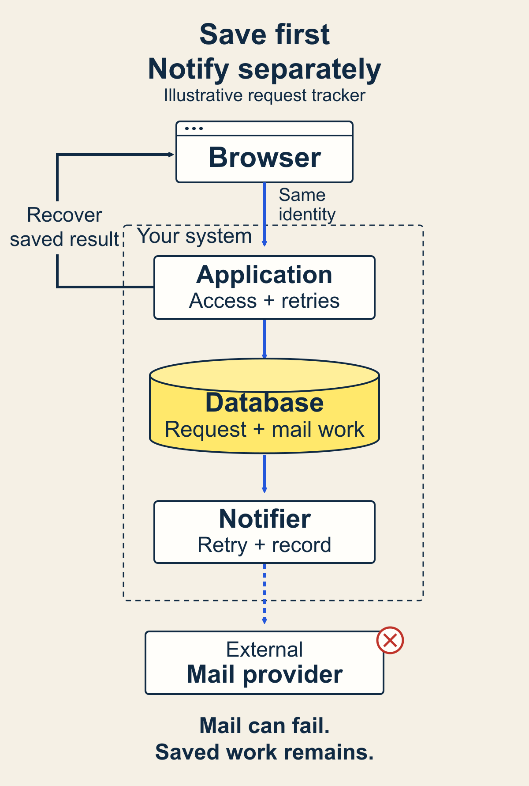

# Choose architecture from the failures the product must survive

A user submits a request. The screen freezes before the confirmation appears. They press Submit again. Should your product create another request, recover the first result, or ask them to start over?

That question can tell you more about your architecture than a list of popular frameworks. You need to know where the accepted request lives, who decides whether the second attempt is a retry, and what the interface can honestly say.

This chapter helps you turn a scoped user experience into an architecture decision record. You will identify the failures that matter, assign responsibilities, compare a small design with credible alternatives, and name the evidence that would make you reconsider it.

The example throughout is a **fictional shared request tracker**. Its requirements and design are illustrative, not results from a deployed product.

## Start with a promise you can inspect

Architecture decisions become easier when you have a small user result to protect. Here, a team member submits a request, sees its saved state, and can return to it later. Other authorized team members can view it. An email may draw attention to a new request.

Write down what must remain true when something goes wrong. In this example:

- A saved request must remain available after the browser closes.
- Repeating the same submission must not create another request.
- Someone outside the team must not read or change its requests.
- A notification failure must not erase an accepted request.
- The interface must distinguish a confirmed save from an outcome it cannot yet determine.

These are proposed requirements for the example. A real team must confirm them, especially whether delayed notifications and temporary unavailability are acceptable.

Use this method when an experience crosses a storage, permission, network, or provider boundary. You can simplify it for a disposable prototype with no shared state or meaningful loss. Even then, say what the prototype leaves unprotected.

Before you begin, gather the scoped experience, its success check, important data, access rules, external dependencies, and the time or skills available to operate it. A vague promise such as “be reliable” is not enough to compare designs.

## 1. Describe failures as user situations

Start with a few concrete situations rather than a catalog of every possible outage.

**The response disappears after a save.** The server may have accepted the request even though the browser never received confirmation. A timeout alone cannot tell you whether the write happened. The next action needs to recover that uncertainty safely.

**An unauthorized person tries the same endpoint.** Hiding a button does not protect shared data. The write and read paths need permission checks at the boundary that serves the data.

**The email provider is unavailable.** If the request is already saved, that fact must remain true. The product needs a separate notification state and a way to retry or disclose the failure.

**The database is unavailable.** The application cannot confirm a durable save. The interface should report that limitation, preserve the user's draft where appropriate, and offer a recovery path. Keeping one application and one database does not provide high availability by itself.

For each situation, answer three questions: What could the user lose? What must the product preserve? What observation would prove the recovery worked?

For the lost response, the check could be: retry the same submission and observe one stored request with the same identity. That is an acceptance test to implement and run, not evidence that the proposed design already passes it.

## 2. Give each fact an authority and each failure an owner

Choose where a fact becomes authoritative. In the tracker, the database record is the authority for whether a request was accepted. The browser displays that state and may retain an unsent draft, but its optimistic confirmation is not the durable record.

Then assign responsibilities:

- **Browser:** collect input, retain the submission identity during retries, and display saved, pending, or uncertain outcomes.
- **Application:** check access, validate input, coordinate the write, and return or recover the accepted result.
- **Database:** preserve request records and enforce the uniqueness and transaction rules the design depends on.
- **Notification task:** process saved notification work, record attempts, and expose unresolved failures.
- **Email provider:** accept an outbound delivery request under its own contract. Provider acceptance does not establish that a person read the message.

This is a responsibility map. It does not require five deployable services. The application and notification task can share a codebase; the task still needs a deliberate execution and recovery mechanism.

The diagram separates the durable save from the external notification. If the mail provider fails, the saved request remains available. The application and database can still fail, so this boundary is not a promise of uninterrupted service.

Trace every failure to an owner. If two components can independently declare the same request accepted, explain how they agree. If no component owns recovery, you have an architectural gap even when the happy path looks complete.

## 3. Sketch the smallest design that protects those promises

For this example, start with one web application and one relational database. Keep permission checks and request acceptance in the application's server boundary. Use an existing identity mechanism through a clear interface rather than treating credential handling as an incidental feature.

For retries, the browser creates an operation identity before sending and reuses it for the same attempt. The server associates that identity with the authorized scope, input, and accepted result. A matching retry recovers that result; changed input with the same identity needs an explicit rejection. Define how long this protection lasts. [AWS's guidance on idempotent APIs](https://aws.amazon.com/builders-library/making-retries-safe-with-idempotent-APIs/) explains the request-identity and retention tradeoffs.

If notifications must survive a crash after acceptance, save the request and its pending notification work in one database transaction. A background task processes that work separately. This is the [transactional outbox pattern](https://docs.aws.amazon.com/prescriptive-guidance/latest/cloud-design-patterns/transactional-outbox.html). It avoids relying on a later, separate write to remember the notification.

An outbox does not make the external effect exactly once. A task can crash after sending but before recording success. Define duplicate handling, bounded retries, and a visible failure state. Do not automatically retry forever or label an uncertain delivery successful.

You now have a compact design with useful limits. You still need to operate the application and database, exercise backup restoration, monitor failed work, and maintain access rules. A small diagram does not remove that work.

If email is truly optional, you may omit durable notification work and openly accept missed notices. That changes the product promise. Record the trade rather than keeping “reliable notifications” in the copy while removing its support.

## 4. Compare alternatives against the same failures

Give each option the same job to perform. Compare how it handles lost responses, unauthorized access, notification failure, and unavailable storage. Then compare operating work, not just initial setup.

**One application with a relational database** keeps the acceptance rules and transaction boundary easy to locate. The operator still owns deployments, restoration checks, task execution, and outage handling. Co-located work may share a failure domain.

**Managed application services or functions with durable storage** may transfer some infrastructure work to providers. You still need to establish where transactions happen, how background work resumes, what the provider guarantees, and how you observe or recover a failure. Verify the actual selected service contracts before relying on them.

**Separate services with a broker** can be justified by independently operated domains, distinct scaling needs, or isolation requirements. They introduce additional deployment, message, consistency, and recovery boundaries. For this small tracker, those costs need a concrete reason.

These are design families, not a universal ranking or a measured cost comparison. Choose the simplest candidate that satisfies the confirmed requirements within the operating capacity you have. If none does, revisit the requirements or gather the missing evidence.

## 5. Write the decision and its price

Keep the architecture decision record short enough to use during implementation. [Michael Nygard's original ADR guidance](https://cognitect.com/blog/2011/11/15/documenting-architecture-decisions) gives a useful structure: context, decision, status, and consequences. Add the failure trace and reconsideration trigger when they make the choice easier to inspect.

Here is a completed **illustrative** record for the tracker:

**Context:** Team members need a durable request and a recoverable result after a lost response. Notifications may be delayed. The assumed operating capacity is one small application and database; that capacity still needs confirmation.

**Decision:** Use one web application and relational database. Enforce access on the server. Bind each submission identity to its scope and input. Store the accepted request and pending notification work together. Process notifications outside the acceptance path.

**Consequences:** Saved requests remain independent of mail availability. We accept temporary application unavailability. We must run and observe background work, define retry retention and duplicate handling, and exercise restoration. We cannot claim that email acceptance proves human receipt.

**Rejected option:** Separate request and notification services at this stage. No confirmed independent operating or scaling requirement currently justifies their additional coordination cost. This is a choice for the example, not a claim that separate services are inherently wrong.

**Uncertainty:** Acceptable notification delay, retry retention, and recovery targets require owner decisions. A provider's failure behavior needs verification. The design remains proposed until its important checks run.

**Reconsider when:** The application cannot meet an agreed availability or recovery target, notification work interferes with request acceptance, or a team acquires a confirmed need to operate a domain independently. Investigate the failing boundary before assuming a full rewrite is necessary.

## Check the decision before you build around it

Use the companion worksheet to map one failure to its authority, detection, recovery, and observable check. It also contains a blank decision record and the completed example. The worksheet is a separate working artifact; the essential method and example are included here.

Ask someone to trace the lost-response scenario through your diagram. They should be able to identify the saved fact, the retry identity, and the visible result without guessing where the rules live. Then trace the notification outage and unauthorized request.

You are ready to implement when every chosen component has a job, every critical failure has an owner and check, the simplest option has been evaluated fairly, and the accepted costs and open decisions are visible. That is design readiness. Runtime checks, representative use, and operational recovery evidence come later.

The lightest useful version is one page: a user promise, three important failures, a responsibility sketch, a decision with its main cost, and one reconsideration trigger. Start there. Add detail when it changes a choice or reveals a missing responsibility.

Your architecture can evolve. Leave a clear reason for today's decision so the next change starts from evidence instead of another framework debate.
