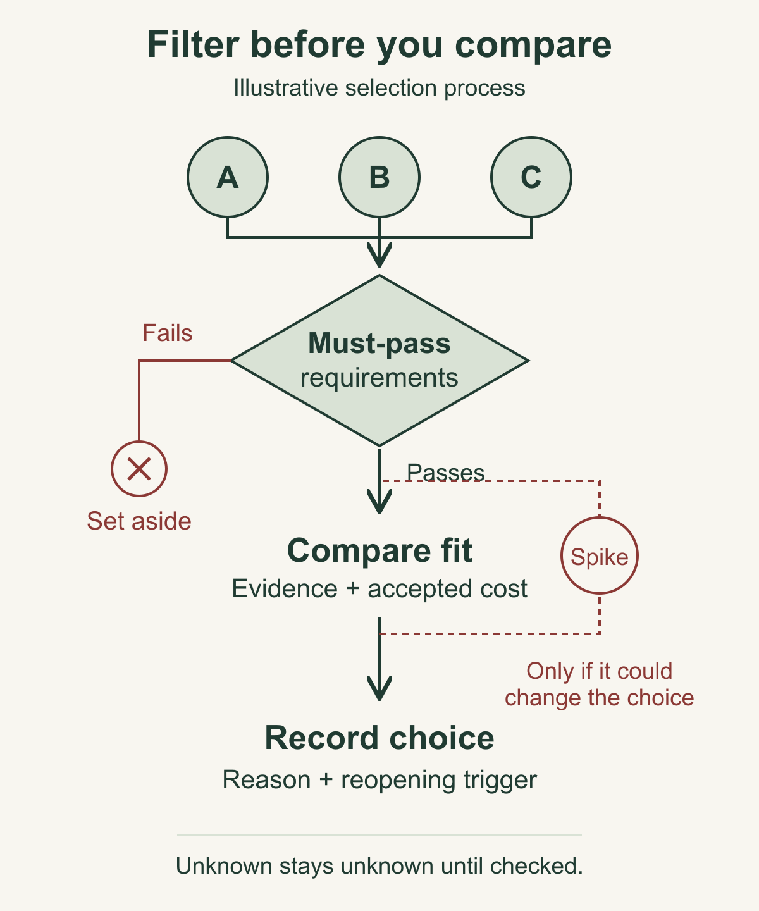

# Choose backend and frontend tools with explicit tradeoffs

You can find a persuasive recommendation for almost any software stack. The difficult part is deciding which recommendation fits the product you need to maintain.

Start with the decisions you have already made about the product: its critical workflow, who operates it, what must survive a failure, and where it needs to run. Turn those constraints into a short comparison. Then choose the smallest experiment that could change your mind.

The result is a stack decision someone else can inspect: what you chose, why it fits, what it costs you to maintain, what remains unknown, and when to reconsider it. You do not need a league table of every popular framework.

## Gather the inputs before the shortlist

Use this method when starting a product, adding a substantial application surface, or considering a stack change whose maintenance consequences matter. For a small feature inside a working system, the existing stack is usually your starting candidate. A new comparison needs a concrete reason.

Bring a short architecture note, the first complete user workflow, the expected operator, and the deployment constraints. If those do not exist yet, write a provisional paragraph rather than pretending they are settled.

Here is the fictional example used throughout this guide. A small team is building a shared request tracker. Members sign in, create a request, assign an owner, and see its current status. Accepted changes must persist even when an email notification fails. The first interface is a signed-in web application. Public search pages are outside this first release.

For this example, assume the maintainer already knows TypeScript and React. That is an illustrative input, not a claim about a real team. Traffic, operating cost, and performance have not been measured. Those unknowns should stay visible in the comparison.

## 1. Separate requirements from preferences

A requirement can eliminate a candidate. A preference helps you choose between candidates that remain plausible.

For the tracker, requirements might be:

- The backend enforces access to each team's requests.
- An accepted request and the work needed to notify its owner can be recorded together.
- Important background work survives an application restart.
- The chosen hosting arrangement can run the required application and database behavior.
- A future maintainer can build and operate the system from written instructions.

Preferences might include one primary application language, familiar React tooling, or fewer independently deployed services. Each preference has a reason, but none automatically proves a candidate works.

Define what would count as evidence for a requirement. "Supports background jobs" is too broad. "After stopping and restarting the application, pending notification work remains available and can be claimed safely" describes something you could check.

Do not let an overall score hide a failed requirement. A candidate that misses a necessary deployment constraint cannot make up for it with attractive syntax.

## 2. Compare connected configurations

A language, frontend framework, database, and hosting arrangement affect one another. Compare a small configuration you could actually build, rather than four unrelated favorites.

The tracker's illustrative shortlist has three options:

- **A: TypeScript on Node.js, a React Router SPA, and PostgreSQL.** A backend owns access and accepted changes. The browser uses that API. Background work needs an explicit durable design and a suitable execution environment.
- **B: Go, the same React Router SPA, and PostgreSQL.** The responsibility split stays similar, but backend implementation, libraries, build tooling, and troubleshooting now involve another language.
- **C: A full-stack React application using Next.js and PostgreSQL.** Server-side application code can sit alongside the interface. The design must still identify who performs durable background work and how it runs on the selected host.

These are plausible alternatives for teaching, not tested deployments or a recommendation that every project use these technologies. Keeping PostgreSQL across the shortlist isolates the runtime and frontend decision. If database choice is genuinely open, compare that separately against the same data and recovery requirements.

For each option, write the output you deploy, the processes that run, where secrets live, and who handles database migrations, backups, and recovery. A framework name alone answers none of those operational questions.

## 3. Give backend and frontend their own reasoning

For the backend, ask what has to execute, what must persist, and what happens when execution stops. Language features can help implement concurrency or cancellation. They do not make an in-memory job durable.

Node.js is worth evaluating when TypeScript familiarity matters. Its [event-loop guidance](https://nodejs.org/en/learn/asynchronous-work/dont-block-the-event-loop) also makes an explicit maintenance concern visible: expensive work on the event loop can delay other clients. A proposed CPU-heavy task deserves its own execution plan. This is a workload question, not evidence that Node.js cannot run the tracker.

Go is a reasonable alternative to evaluate when its tooling and execution model fit the service. For this fictional maintainer, choosing it also means accepting another language, dependency ecosystem, and diagnostic workflow. Do not claim that this cost is justified by better speed or memory use without relevant measurements.

For the frontend, start with the pages and interactions. A signed-in application with an existing API may fit a client-rendered SPA. Public pages that need server-rendered content could justify a different rendering arrangement. The point is to name the requirement that changes the choice.

React Router's [SPA guide](https://reactrouter.com/how-to/spa) documents disabling runtime server rendering with `ssr: false`, producing an HTML entry at build time and using client loaders and actions. The static host still needs to send application routes to the entry document. A deep-link refresh is therefore a useful deployment check.

Next.js is an alternative when its server features help the actual workflow. Its [deployment guidance](https://nextjs.org/docs/app/getting-started/deploying) distinguishes server deployments from static export, which has limited feature support. Compare the rendering mode you intend to use. Do not assume a static export preserves every server capability.

Neither rendering approach removes your responsibility to test keyboard use, loading and failure states, access controls, or stale data after a mutation.

## 4. Make the comparison traceable

Use one row per decision criterion. Record the candidate's fit, the evidence, the accepted consequence, and any unanswered question. You can use a table in your working document without assigning numerical scores.

For each statement, choose an evidence label:

- **Documented:** an official source describes the capability under stated conditions.
- **Observed:** a bounded check demonstrated behavior in a named configuration.
- **Preference:** the operator values something, such as familiar tooling.
- **Unknown:** the evidence needed to decide is missing.

In the example, "the maintainer knows TypeScript" is an assumed preference input. "The SPA host needs an application-route fallback" is documented behavior. "The deployment recovers pending notification work correctly" remains unknown until checked. Never promote the first two statements into the third.

The illustrative decision can now be short: keep A as the provisional selection because it preserves the assumed maintainer familiarity and fits the proposed API boundary. Keep B as an alternative, with its extra language cost made explicit. Defer C because the first workflow has no established need for server-rendered application pages, while noting that an integrated server arrangement could become useful later.

That rationale is conditional. It does not say A is fastest, cheapest, safest, or easiest for every team. Another maintainer or a different page requirement could reasonably produce another choice.

## 5. Check database and hosting consequences

For the tracker, accepted state and notification intent need a shared commit boundary. PostgreSQL's [transaction tutorial](https://www.postgresql.org/docs/current/tutorial-transactions.html) explains grouping changes into an all-or-nothing operation. That capability supports the proposed design. It does not prove the application uses transactions correctly, that an external email was delivered, or that a backup can be restored.

Record database connection ownership, schema migration ownership, and the recovery check you need. If an alternative datastore is proposed, ask it to meet the same requirements. Do not substitute a familiar brand for the comparison.

Hosting can also invalidate a configuration that looks sensible locally. Check whether the selected environment allows the execution you need, how application and database connections are bounded, what happens on restart, and how a browser reaches the API.

Separate frontend and backend hosts introduce an explicit origin and authentication boundary to verify. A combined deployment has different release and failure coupling. Neither arrangement wins automatically. Write the consequence you are accepting and check it in the intended configuration before treating the stack as ready.

## 6. Run a spike only if its answer could change the choice

A spike is a bounded experiment that resolves one decision. It should end with evidence, not an attractive prototype and a growing feature list.

Suppose the provisional choice depends on the proposed hosting arrangement allowing durable notification processing. Write the spike brief before building:

- **Question:** Can this configuration recover saved notification work after an application restart?
- **Scope:** One illustrative request, one pending work record, and a simulated notification adapter. No real users or email sends.
- **Checks:** Save the request and work together, interrupt processing, restart, and inspect the saved state and retry behavior. Separately refresh a signed-in application deep link.
- **Effort cap:** One agreed work session. This is an illustrative cap, not an estimate of implementation time.
- **Decision rule:** Keep the candidate if the required behavior is demonstrated. If it fails, identify whether the cause is application code, configuration, or a platform limit before rejecting the stack. If the session ends without evidence, record the unknown and decide whether it blocks proceeding.

These checks are a proposed exercise. They have not been executed for this fictional tracker. They do not establish capacity, production readiness, or safe handling of real data.

Do not run a benchmark simply because numbers would make the matrix look more authoritative. Measure when a realistic workload and a decision threshold make the result useful.

## Preserve the reason and the reopening rule

Save a dated decision with the configuration, its status, evidence links, rejected alternatives, accepted maintenance costs, and blocking unknowns. A provisional selection is useful as long as its conditions are clear.

Set specific triggers: a required rendering capability changes, the deployment cannot support the necessary work, a dependency loses support, or a measured workload breaks an agreed threshold. A new release announcement by itself is not a reason to rewrite the product.

Your completion check is simple: can another maintainer explain the chosen configuration, one credible alternative, the cost you accepted, and the evidence still needed? If the answer is only "this stack is popular," the decision is unfinished.

The smallest useful version is one paragraph, two candidates, one decisive requirement, and one reopening trigger. Expand it when the consequence deserves more scrutiny. Preserve a working stack when it still fits, and spend your next effort on the uncertainty that matters.
