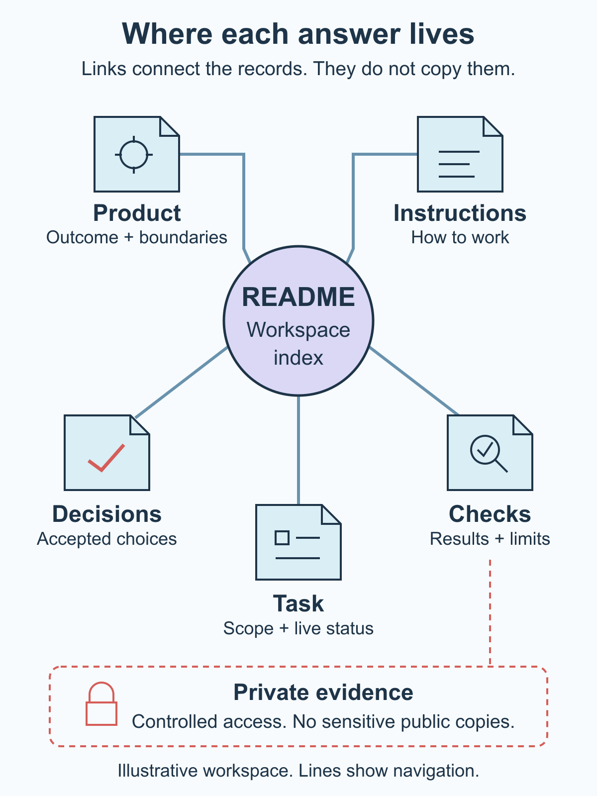

# Create a workspace that another person or agent can understand

You open a repository after a few weeks away. The code is there, but the current decision is buried in a chat, an old plan describes a different approach, and the task says "almost done." Before changing anything, you have to reconstruct what is actually true.

A useful workspace gives the next person or agent a short route through that uncertainty. It shows what the product is trying to do, which decisions govern the work, what this task allows, and what evidence counts as completion.

You can build that route without creating a second project management system. Give each kind of information a canonical home, then connect those homes with a small map. Keep the map navigable and the records honest about their authority.

## Start with the questions a newcomer must answer

Use this approach when work crosses people, repositories, or chat sessions, or when a project has accumulated decisions that no longer fit in a quick introduction. It also helps a solo builder returning to work they no longer remember clearly.

Before choosing folders, write four questions:

- What outcome are we trying to produce?
- Which current decision governs this change?
- What may I change, and which actions need separate authorization?
- What checks and evidence are required before I call the task complete?

Bring the repository, the current product boundary, an active task, and whatever instructions already exist. You are organizing real information, so missing decisions should remain visible. Do not fill gaps by copying an old project or guessing what a previous conversation meant.

The running example is a fictional shared request tracker. A team member can create a request, assign an owner, and inspect status. The example task is to explain notification status more clearly. It permits a small interface change and its tests; it does not authorize changing email providers, moving infrastructure, or publishing a release.

## 1. Give different kinds of truth different homes

"Single source of truth" does not require one enormous document. It means knowing which record owns a particular answer.

A small project can use these homes:

- **Entry point:** the root `README.md` explains the project and links to the records a newcomer needs first.
- **Working instructions:** `AGENTS.md` holds repository conventions, reading routes, relevant commands, and action boundaries for coding agents.
- **Product and decisions:** a short product document defines the intended outcome and non-goals. Decision records preserve accepted choices, their reasons, alternatives, and later replacements.
- **Specifications and checks:** an affected feature has a behavior contract and a way to verify it.
- **Task status:** the issue tracker owns the active task, scope, assignee, dependencies, and current state.

Verification results need a home too. Put a small, sanitized check record beside the work when it belongs in the repository. Keep sensitive evidence in approved private storage and link only an access-controlled reference from the appropriate internal record.

These are roles, not a mandatory folder count. A tiny project can combine its product description and entry point. A tracker can hold a small task's acceptance criteria. What matters is that a reader can tell where to find the current answer and where to update it.

GitHub's [README guidance](https://docs.github.com/en/repositories/managing-your-repositorys-settings-and-features/customizing-your-repository/about-readmes) describes the README as a place to explain a project and how to get started. Use that entry point to guide navigation, rather than repeating every detailed policy there.

## 2. Make the entry point a map

Give the README a short reading route. A newcomer should know which file answers which question before reading the whole repository.

For the illustrative tracker, the route could be:

- Start with `docs/product.md` for the user outcome and explicit non-goals.
- Read `AGENTS.md` for the working rules and the route to component-specific instructions.
- Open `docs/decisions/notifications.md` for the accepted notification boundary.
- Read the assigned issue for the exact change and allowed files.
- Follow its links to `docs/specs/notification-status.md` and the relevant checks.

The issue tracker owns whether the task is active or complete. The product file does not need a second task-status table. The README can link to the current work view without promising that a copied status is still fresh.

Use descriptive links and paths that make sense from a fresh checkout. Check that they resolve. Avoid instructions such as "see the document we discussed" or a path that works only on one person's laptop.

The shortest useful map can fit in a few lines: product, instructions, decisions, task tracker, and checks. Add a location only when it answers a question someone actually needs to ask.

## 3. Keep instructions short and specific

An instruction file is most useful when it tells an agent how to work in this repository. It should not become another copy of the product plan, task backlog, or architecture history.

The [AGENTS.md format](https://agents.md/) provides a conventional place for project context and coding-agent instructions. Its examples include setup, testing, and code conventions. Reading the file is still a behavior to check with the particular tool you use; a filename alone does not guarantee compliance.

A practical outline includes the repository's purpose, the first documents to read, commands that are actually maintained, the scope of nested instructions, and completion expectations. If a component has special checks, put those instructions near that component and link to them from the root.

Write boundaries that help someone act. "Be careful with production" leaves too much interpretation. For the fictional interface task, a clearer instruction is: the task covers the named interface and tests; provider changes and release actions require their own explicit authorization.

Avoid copying command lists into several files. Point to the maintained command definition or component guide. When a command changes, update its canonical instructions and the links that depend on them. Do not assume that a command in an old transcript remains valid.

## 4. Distinguish a decision from its history

Old notes can contain useful reasoning while no longer governing the work. Preserve that history without making a reader guess which version applies.

A decision record should identify its status, scope, date, accepted choice, and the record it replaces, if any. Keep proposed options visibly separate from accepted choices. A recommendation does not become a decision because an agent repeats it in a summary.

In the fictional tracker, the current decision says the application records notification intent after accepting a request; sending the notification is a separate concern. An earlier note proposes waiting for email before showing success. Mark that older proposal as historical and link it to the accepted record. Do not quietly leave both documents labeled current.

The next interface task should follow the accepted boundary and explain pending or failed notification work accurately. It should not redesign the acceptance path because a familiar old note appeared first in search results.

If two current records disagree, pause the dependent change and bring the conflict to the person who can decide it. A workspace map can expose ambiguity. It cannot resolve product authority by filename, recency, or confident wording alone.

## 5. Connect the task to scope and evidence

The task is the bridge between the product decision and a particular change. It needs enough context to stand on its own when the original chat is unavailable.

For the illustrative notification-status task, record:

- **Outcome:** members can distinguish a saved request from a notification still waiting to be sent.
- **Inputs:** the accepted notification decision and the current status behavior specification.
- **Allowed changes:** the named interface component, its tests, and an associated sanitized check record.
- **Exclusions:** no provider selection, delivery guarantee, production data, infrastructure change, or release action.
- **Checks:** verify the saved-and-pending state, an unavailable notification state, keyboard access, and existing behavior covered by the affected tests.

Use the repository's actual branch and review conventions. Record the base revision or comparison reference needed to identify the work. A branch label identifies a working area; it does not establish that its changes were reviewed, merged, or deployed.

When recording results, say what ran and what it showed. A local component check is different from a hosted journey. A passing notification-interface test does not prove a real email arrived. If a required check was not run, preserve that gap rather than treating a status change as its substitute.

This guide's tracker task is illustrative. No application code, hosted journey, notification delivery, or independent fresh-chat exercise has been executed for that fictional product.

## 6. Keep private evidence out of the public route

Make the public map usable without publishing credentials, customer records, internal transcripts, or raw logs. Describe where an authorized contributor requests access instead of pasting sensitive material into the repository.

For example, a public check record can say which behavior was checked, which revision was examined, and which limitation remains. The underlying evidence can stay in a private location with a named custodian. A link does not grant access, and an inaccessible link does not count as evidence the reviewer inspected.

Do not rely on deleting a secret from the latest file after committing it. GitHub's [sensitive-data guidance](https://docs.github.com/en/authentication/keeping-your-account-and-data-secure/removing-sensitive-data-from-a-repository) explains why copies and repository history complicate removal, and why exposed credentials need prompt revocation or rotation. Prevent the disclosure before it enters the public history.

Keep configuration examples to names and safe placeholders. Record how to obtain access through the approved channel, with enough context to identify the purpose. Do not turn onboarding documentation into a credential store.

## Test the map before expanding it

Open the entry point as if the original conversation were gone. Ask someone, or start a fresh agent session, to locate the outcome, governing decision, allowed changes, and checks using only the map and its linked records.

Ask them to report the exact locations and anything they could not establish. Finding the right filenames is insufficient if the task scope remains unclear. Record whether the exercise used a genuinely fresh reader, what access they had, and what remains untested.

You can also do a local link and consistency check yourself. That catches broken paths and duplicated claims, but it does not prove that a new person will understand the workspace. Keep the two results separate.

Use the companion to list the canonical homes, draft the instruction-file outline, and prepare a handover. Start with one representative task. Repair the map when it leads to a dead end, a conflicting decision, or a missing check.

For a small project, the lightest useful version is a short README, a concise instruction file, and one linked task containing its decision and acceptance criteria. Split records when they have different owners or change for different reasons. Keep the next action understandable before adding more process.
