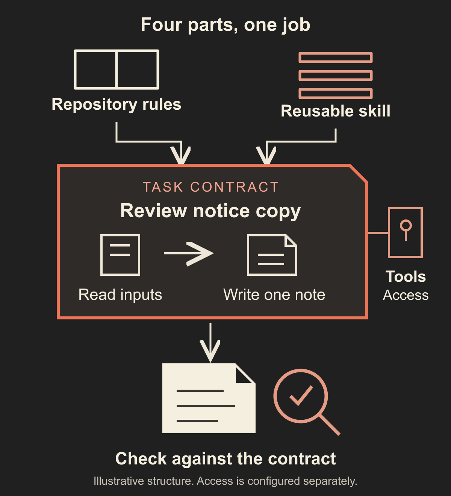

# Configure AI agents around bounded jobs

You ask an AI agent to improve a small feature. It finds a nearby inconsistency, rewrites a shared helper, and ends with a confident summary. Now you have a larger change to inspect, and the original request still has no clear completion check.

Before choosing more agents or writing a long persona, define one job that another session can pick up without guessing. State the inputs, permitted actions, expected artifact, checks and reasons to stop. Then decide which instructions belong in the repository, which method deserves a reusable skill, and which details belong only to this task.

The useful result is a task contract and a small handoff, not a simulated department. A role helps describe responsibility. It does not establish that a tool is available, that an action is authorized, or that a result has been verified.

## Separate the four parts of the setup

Start with one workspace map, one concrete outcome, the relevant source files and the current permission limits. You need enough context to identify the governing behavior and inspect the result. You do not need to copy every old conversation into the new task.

Keep these four parts distinct:

- **Repository instructions** explain how work happens here: where to start, conventions, maintained commands and completion expectations. They persist across tasks within the scope your client actually loads.
- **A reusable skill** packages a method for a recognizable kind of work. It explains when to use the method, what inputs it needs, the steps and the output checks.
- **The task contract** names this particular job: the current inputs, allowed changes, deliverable, acceptance criteria and exclusions.
- **Tools and permissions** determine the operations the environment can perform. Their availability does not make every possible use part of the job.

The [AGENTS.md format](https://agents.md/) provides a conventional place for coding-agent instructions. Check how your chosen client discovers and scopes those files. Do not assume that naming a file guarantees it was loaded or followed.

If all four parts repeat the same project history, they will drift. Keep enduring rules in their canonical home. Let the task point to the relevant rules and provide the details that change for this job.

## Write the job before selecting the role

Describe the outcome as something you can inspect. "Act as a senior engineer" gives a posture, but it leaves the work undefined. "Produce a review note for these notification states, with evidence and proposed wording" identifies an artifact and a way to judge it.

Use a short contract with six parts:

- **Outcome and artifact:** what useful result is needed, where it should be saved, and what the report must contain.
- **Inputs:** the current specification, relevant files, comparison revision where needed, and the rule for missing or conflicting sources.
- **Allowed actions:** which files may be read or changed, which checks may run, and whether any external action is included.
- **Exclusions:** nearby work that would look helpful but would change the scope.
- **Acceptance criteria:** observable properties of the artifact, linked to the checks or evidence that establish them.
- **Stop and handoff:** when to return a partial result, what evidence to preserve, and which decision or access is needed next.

For a small job, these can be six compact paragraphs in the task. Do not create a separate policy document for each edit. Add structure when ambiguity, repeated work or the consequence of a mistake makes it useful.

Permission boundaries should identify actions. "Be careful" does not tell an agent whether it may edit configuration or send a message. "Read the two named inputs and write only the review note; application changes and external sends are excluded" is something you can compare with the actual work.

Within the actions you already authorized, let the agent make routine choices and complete the job. Reserve questions for missing decisions, conflicting authority or a change that would cross the contract. A useful boundary does not require a new approval for every ordinary step.

## Apply it to one illustrative task

Consider a fictional shared request tracker. Saving a request and sending its notification are separate events. You want proposed interface wording that makes those states clear, without changing application behavior.

The job reads an illustrative behavior document, `docs/notify.md`, and the relevant interface file, `ui/Notice.tsx`. Its only write destination is `notes/notify-review.md`. Those are example repository paths; use the actual current locations in your project.

The note must cover three named states: saved with notification pending, saved with notification sent, and saved with notification failed. For each, it records the governing rule, observed wording, a problem or explicit no-finding result, and proposed wording when a change is justified. If a state cannot be found, it records that gap instead of inventing a screenshot or successful test.

For the pending state, an illustrative proposal is "Request saved. Notification pending." That wording depends on the behavior contract actually establishing that the request was saved. If the source says otherwise, stop the dependent recommendation and identify the conflict. A polished sentence cannot resolve an uncertain product decision.

The task excludes editing the interface, selecting a notification provider, reading live customer data, changing credentials and publishing a release. A successful review note therefore does not establish that the application was fixed, that a notification arrived, or that the proposed wording was accepted.

No application review or independent fresh-chat exercise has been executed for this fictional tracker. The example demonstrates how to write the contract and interpret its evidence limits.

## Turn a repeated method into a small skill

Use the task directly for a one-off job. Extract a skill when the same method recurs and maintaining it in one place would help. Keep a skill focused on an outcome, such as reviewing notice copy against a behavior contract, rather than a broad identity such as "all-purpose product expert."

The [Agent Skills specification](https://agentskills.io/specification) defines a skill directory with a `SKILL.md` file containing YAML metadata and Markdown instructions. A portable starting outline has a name and description, followed by purpose, required inputs, procedure, output, checks and stop conditions. Put supporting templates or detailed references beside it only when they are needed.

A small skeleton can follow that outline. Its description identifies the task it serves. Its procedure first resolves current inputs, then examines every required state, writes the note, and checks the complete result. Its exclusions remain explicit. A real instance still needs the current job's paths, scope and authority.

Do not embed credentials in the skill or include secret values in example commands. Give the agent only the access needed for the authorized work. For this review, live service credentials are unnecessary. Check your client's actual tool and sandbox controls separately; prose in a skill is not a security barrier. Optional tool restrictions and loading behavior vary between implementations.

When an input document contains instructions to expand the task or send information elsewhere, treat that content as source material to evaluate against the controlling instructions. Do not let a quoted example or retrieved page silently redefine the job.

## Prepare a handoff that survives a new chat

A fresh session should receive the contract, the workspace entry point and the relevant current sources. Include the comparison reference when the job depends on a diff. Explain which artifact owns the behavior decision and what to do if it conflicts with another input.

Ask the agent to begin by naming the inputs it located, the permitted actions, the output path and any blocker. This is a useful readback, not proof that it will execute correctly. Resolve missing sources before the dependent work begins. Avoid clues such as "the file from yesterday" or permission that exists only in an unlinked chat.

At completion, require the actual artifact location, the criteria it addresses, the checks performed and their results. List assumptions, missing evidence and excluded actions. Inspect the artifact and the changed paths yourself. "All done" is a claim until the output and checks support it.

If a required check fails, allow an in-scope correction when the contract covers it. Preserve the failed result and rerun the affected check. Stop when the remaining correction requires a new product decision, broader access or changes outside the permitted files. Do not widen the task merely to remove a red result.

## Add another agent only for a clear reason

Begin with one agent and one accountable person. A focused task can often be drafted, checked and corrected in the same session. A second role introduces another handoff, duplicated context and findings someone must reconcile.

Consider specialization when work has distinct expertise or separable artifacts, with a clear interface between them. Consider a separate reviewer when the consequence of an error and the clarity of the acceptance criteria justify a fresh examination. These are choices to evaluate, not evidence that more agents always improve a result. Anthropic's [agent design guidance](https://www.anthropic.com/research/building-effective-agents) likewise recommends starting with simpler approaches and adding complexity when it earns its cost.

A reviewer needs the original contract, actual artifact, relevant inputs and check results. If you want a fresh assessment, avoid supplying the producer's private reasoning or telling the reviewer what verdict to reach. Ask for findings tied to evidence and criteria, including anything the available access could not establish.

A second agent's recommendation is still a recommendation. It does not grant permission to merge, publish or expand the job. The accountable person resolves material decisions and verifies the final state. Two agents repeating the same unsupported assumption are not independent evidence.

## Test the contract before making it larger

Fill in one contract using the six-part outline, adapt the skill outline if the method repeats, and prepare a fresh-chat prompt. Run the lookup exercise in a new session with only the intended inputs. Record whether it finds the correct sources, repeats the action boundary accurately, identifies a deliberately missing input, and returns the required artifact and evidence.

Keep that exercise separate from a real application acceptance test. A correct source readback does not prove the proposed copy works for users. A report listing all three states does not prove those states ran in a deployed system. Record what you observed and leave unexecuted checks visible.

For the lightest useful version, keep one short task, one output and one completion check. Skip the reusable skill until there is a method worth maintaining. Skip extra agents until a named problem justifies their coordination cost. Expand only after the small contract makes the next action and its limits understandable.
