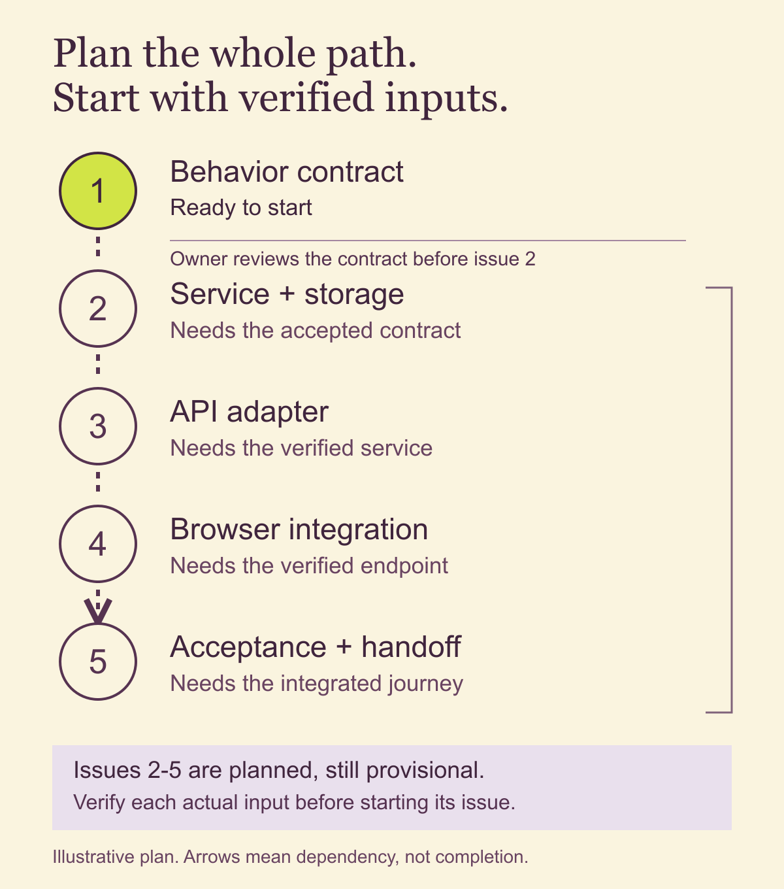

# Plan issues before asking an agent to build

A task list can look complete while leaving the hardest connection unowned. You have an issue for the interface and another for saving data. Then someone asks which task connects the real response to the screen, checks the failure state, or gets the finished journey accepted.

Before asking an agent to build, turn the outcome into a small delivery plan. Give each piece a clear result, name the dependencies, and show where execution must wait for a decision or an actual upstream artifact.

The aim is a plan you can inspect and start safely. It cannot remove uncertainty, but it can make known missing work visible before that work becomes a surprise.

## Start with an observable finish

Use this method when a change crosses components, needs a handoff, or will run for a while without you watching. A small text correction may need only one issue. A feature that touches storage, an API and a browser deserves a look at the whole path.

Bring three inputs: the chosen user outcome, the current implementation or design, and the decisions that constrain the work. If a necessary decision is missing, name it. A plausible answer invented during planning is still an assumption.

Write a finish that someone can observe. For example, the following is fictional:

An authorized teammate can change a request from Open to Resolved in a local test environment. Refreshing the page preserves the saved status. A failed save keeps the last confirmed status visible and explains the failure.

That finish gives the plan more shape than “build request management.” It also gives you an exclusion list: no new notification service, production rollout or status redesign. The example assumes sign-in and request reading already work, and the owner has chosen the allowed status transition.

## Separate refinement, planning and saving the backlog

You do not need to adopt Scrum to use a clear issue contract. If you do use it, keep the terms straight.

The [Scrum Guide](https://scrumguides.org/scrum-guide.html#product-backlog) describes refinement as ongoing work to break down and clarify backlog items. Sprint Planning establishes a goal, selected work and a delivery plan. The Sprint Goal is the commitment; the detailed plan can adapt as you learn.

Saving that plan into Linear is a tool step in the workflow described here. Creating projects, milestones, issues and relations is not an extra Scrum event, and an issue appearing in a cycle does not make its inputs ready.

For a solo builder, the useful sequence is simple: clarify the work, choose what to attempt, then save and verify the resulting plan. Keep product decisions with the person who owns them. An agent can investigate technical details and prepare options without silently selecting a new product behavior.

## Trace the complete delivery path

Walk backward from the finish, then forward from the available inputs. Ask what must exist for each connection to work.

Cover setup, implementation, integration, verification, review, acceptance and cleanup where they apply. Include configuration, adapters, test data and evidence handoff. These do not all need separate issues, but each necessary result needs an owner.

For the fictional tracker, “database change” and “status button” leave a gap. Something must translate a browser request into an authorized operation, return the actual saved result, and map errors back to the interface. Name that API adapter explicitly rather than assuming a broad “integration” task will absorb it.

Use these five bounded issues as a starting plan. They are illustrative contracts, not a report of executed software:

1. **Agree the status-change contract.** Inputs: the chosen transition and current read model. Output: request/response examples and acceptance cases. Scope: behavior and fixtures only. Acceptance: success, forbidden access and failed-save behavior are unambiguous. Verification: walk each example with the owner. The planner owns this issue; the owner accepts the behavior contract.
2. **Persist an authorized status change.** Input: the accepted contract. Output: the service operation and storage change. Scope: existing request records and access rules. Acceptance: allowed changes persist; forbidden changes leave data untouched. Verification: focused service and database tests. The implementation agent owns delivery.
3. **Connect the API adapter.** Inputs: the verified service operation and request contract. Output: a reachable local endpoint with explicit error mappings. Scope: transport and authorization context, with no new product behavior. Acceptance: real requests return the saved status or the agreed error. Verification: endpoint checks against the service, including forbidden and failed requests. The implementation agent owns delivery.
4. **Connect the browser to the real result.** Input: the verified endpoint. Output: the integrated status control and feedback states. Scope: this request screen. Acceptance: pending, success and failure states match the contract; refresh shows persisted data. Verification: browser checks against the local service, including keyboard use. The implementation agent owns delivery.
5. **Accept and hand off the complete journey.** Inputs: the integrated build and test fixtures. Output: recorded results, owner acceptance, run instructions and fixture reset evidence. Scope: the agreed journey and disposable local test data. Acceptance: every finish condition has evidence and no failed check is called complete. Verification: repeat the end-to-end cases, review them with the owner, and confirm the fixture reset. The delivery agent prepares the evidence; the owner accepts the result. A failure returns to its responsible implementation issue before acceptance resumes.

Each issue ends in something you can inspect. The last one is real work: a collection of individually passing components is not evidence that the connected journey works.

## Plan downstream work without pretending it is ready

You can identify the API adapter before the service exists. You cannot honestly claim its actual interface has been verified yet.

Give every issue a readiness note. Use three plain dispositions: ready to start, provisional until a named dependency is verified, or waiting for a named decision. An issue can be well planned and still be provisional.

In this example, the first issue can start from the stated inputs. The other four are provisional. Before each starts, inspect its predecessor's actual accepted output, reconcile the contract and checks, and revise the estimate if necessary. A closed upstream issue is a pointer to evidence, not a substitute for reading that evidence.

Record the overall disposition too. Here it is “ready through the behavior-contract review.” After that review, reassess the remaining chain. If the owner has already accepted that contract, name the next unresolved checkpoint instead of asking for the same decision again.

For a short sequence, working on one implementation issue at a time makes dependencies easy to inspect. Parallel work can help when inputs are stable and ownership does not overlap. It also adds coordination. Do not start dependent work early just to keep agents busy.

## Write issue briefs that survive a fresh chat

A useful issue brief should answer these questions without relying on an old conversation:

- What observable result does this issue own, and who is accountable for it?
- Which verified inputs does it use, and where can the executor inspect them?
- What can change, and what must stay untouched?
- What acceptance cases distinguish success from a partial result?
- Which checks will produce evidence, and where will that evidence be saved?
- Which dependency, owner decision or unexpected condition stops the work?

“Add tests” is too vague. Name the behavior and the check: a rejected save must preserve the last confirmed status, tested against the local endpoint with an injected failure. Mark that test as planned until it actually runs.

Keep review and correction work visible when sizing the issue. Split an oversized issue by bounded result, preserving every acceptance obligation. A tracking parent summarizes its children; counting its estimate again would count the same work twice.

Use points only as a local sizing convention if they help your team. They do not supply a duration by themselves. A useful calendar forecast needs comparable observations, a defined finish, assumptions and an uncertainty range. If those are missing, record the duration as unknown and identify the next checkpoint that will improve the forecast.

## Preserve the opening plan, then verify the saved objects

Before execution, save the selected outcome, opening issue set, original estimates, dependency order, owner checkpoints and exclusions. Keep contingent work separate. Record later additions and revisions with their reason instead of overwriting the opening plan.

Preserving that snapshot does not freeze all learning. It lets you distinguish the work you selected from work you discovered later. An unknown interface may legitimately change the plan; a known adapter should already have an owner.

When authorized to save the backlog in Linear, prepare the exact intended fields first. Include the project or milestone, state, assignee, estimate and dependency edges. Keep temporary planning labels separate from real returned issue identifiers.

Create or update only the intended objects, then read them back. Check titles, complete briefs, membership, estimates and relation direction. If the browser depends on the API adapter, the adapter should block the browser, not the reverse. Check the reciprocal relation too. Reconcile the returned inventory with the opening record, and retain verified identifiers after a partial write so a retry does not create duplicates.

This article's example stops at a planning artifact. No example issues have been created, no application has been built, and no execution-time improvement is claimed.

## Check the plan before handing it over

Try the exercise with your own small milestone. Hide the explanatory prose and follow only the issues from input to final acceptance. Look for an output that the next issue expects but no earlier issue produces.

A useful completion check is that every required behavior has an owner, every leaf names its inputs, output, scope, acceptance and verification, and the first executable issue has actual inputs. Later issues should name what makes them ready. Owner decisions, review, corrections, evidence and cleanup should be visible, with no implied production release.

The smallest useful version is one outcome, one issue with those fields, and one observable acceptance check. Use a short dependency list when a diagram would add little. Skip a formal sprint meeting or point estimate when it does not help a real decision.

Stop planning when you can safely start the next bounded piece and can see the route to the finish. Return to the plan as evidence arrives. A useful plan makes the next action clear while keeping its uncertainty honest.
