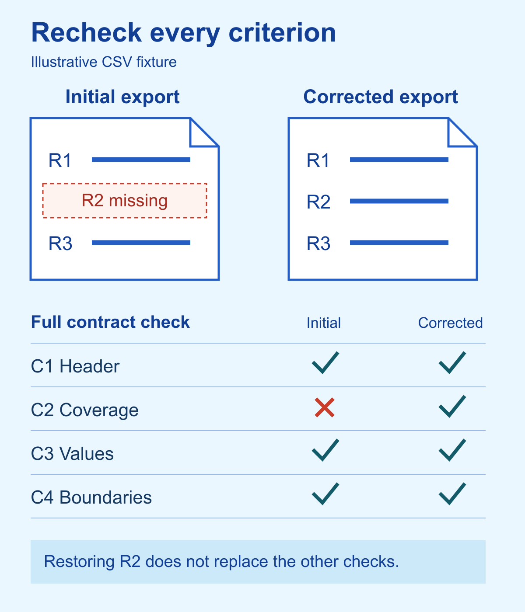

# Build a producer-reviewer loop that checks the actual work

“The export includes every record, preserves the fields and is ready to use.” That is a completion claim. To check it, you still need the export, the original input and the rules it was supposed to follow.

A persuasive summary can hide a missing row just as easily as a missing requirement in a specification. When an AI agent produces the work, asking another agent whether the summary sounds reasonable leaves that gap intact.

A useful producer-reviewer loop starts with an inspectable contract and ends with verification of the actual result. This guide shows how to prepare that loop, give a fresh reviewer the right inputs, handle findings and stop corrections before they become an endless conversation.

## Decide whether another review is useful

Use a separate review when an important omission could survive a quick self-check. Examples include a change across several files, a comparison with a defined candidate set, or an export that must preserve every source record.

For a small wording edit with an obvious result, read the diff and run the relevant check yourself. A second agent adds coordination and waiting. It should answer a question that your simpler check leaves unresolved.

The evaluator-optimizer pattern in [Anthropic's 2024 guide](https://www.anthropic.com/research/building-effective-agents) also centers evaluation criteria and feedback. Treat it as design guidance, rather than evidence that an extra model improves every task.

Keep three responsibilities clear. The producer makes the deliverable and checks its own work. A fresh reviewer examines it against the original contract. The controlling task, or parent, adjudicates findings and verifies the final handoff. These are responsibilities, not a requirement to create a permanent team or controller.

## Freeze what the result must satisfy

Before production, write the objective, exact output, acceptance criteria, permitted changes, exclusions and required evidence. Give criteria stable labels so a finding can point to the rule it violates.

For completeness-sensitive work, define the population too. “Review all relevant items” leaves the reviewer guessing. Name the items, or state how they will be included, excluded and discovered, with a stopping rule. If a comparison crosses candidates and evidence categories, every required combination needs a disposition, including an explained unknown.

Here is a fictional export contract used throughout this guide:

- **C1:** The CSV header is exactly `id,title,status`, in that order.
- **C2:** The three source identifiers, R1, R2 and R3, appear once each in source order.
- **C3:** Every exported record's field values match its source record. An empty title is a valid value.
- **C4:** The source fixture stays unchanged. The producer may write only the agreed export in its assigned output folder.

The inputs are a frozen three-record fixture and this contract. The result is one CSV and its verification evidence. Changing the data model, inventing titles and publishing the export are outside scope.

A reviewer cannot settle a missing product decision by choosing a convenient interpretation. If blank titles have not been allowed or forbidden, resolve that choice before asking the producer to encode it. If the owner changes the contract later, save a new version and explain the change.

## Have the producer return the artifact and its evidence

Ask the producer for the actual output location or changed-file list, a criterion-by-criterion self-check and the checks it ran. Include assumptions, unavailable evidence and untouched boundaries.

Every criterion should appear once in that self-check. A row marked blocked with a reason is more useful than a silent omission. For an enumerated set, request a coverage ledger so you can see whether a member disappeared between the input and the conclusion.

Do not confuse that self-check with independent review. It helps the next person navigate the work, but the producer's verdict does not establish correctness.

In the fictional export, the initial output contains R1 and R3. R2 had an empty title and was filtered out. The file still has the right header, looks tidy and contains plausible values. Checking formatting alone will miss its failure to cover the source population.

## Give a fresh reviewer the original contract

Start the reviewer in a separate context after production finishes. Provide the frozen contract, actual artifacts, source material it is allowed to inspect, checks it may reproduce and unavoidable environment limits.

Keep the producer's conversation, explanation, proposed fix and claimed verdict out of the initial review packet. The reviewer needs to form its assessment from the contract and work. Relabeling the producer's own conversation as “reviewer” does not create that separation.

Fresh context does not guarantee independent reasoning or different mistakes. A second model is still fallible. Research on [LLM judges in conversational benchmarks](https://arxiv.org/abs/2306.05685) documents biases and reasoning limits; it does not establish a correctness rate for your repository review.

Make the reviewer read-only by default. It should examine the whole contract, including omissions, no-touch boundaries and verification evidence, then report all material findings visible in that pass. It should not repair the file while judging it or stop searching after the first known defect.

Useful findings contain a stable identifier, the failed criterion, precise evidence, the consequence and the required outcome. Keep blocking failures separate from advisory improvements.

## Turn the missing row into a finding

An illustrative reviewer finding for the export would be:

**F1, blocking, C2:** The source sequence is R1, R2, R3. The exported sequence is R1, R3. R2 is missing, so the export does not preserve the agreed population. Restore R2 without changing its empty title, then recheck C1 through C4.

That finding identifies an observable mismatch. “The export could be more robust” does not tell the producer what failed. “Add an automatic title generator” introduces a new feature that the contract does not request.

The parent checks F1 against the fixture and export. If the mismatch is confirmed, it accepts the finding and sends it to the same producer for correction. A preference for a different filename can remain advisory when the agreed name already satisfies the contract.

If the reviewer cannot access the source, preserve that limitation. It cannot turn “I could not check the population” into “the population is complete.” If fixing the issue requires a new behavior, permission or owner decision, pause that correction at the named boundary.

## Correct the deliverable, then recheck the whole contract

The producer restores R2, retaining its empty title. The correction should address the cause of the omission, rather than weaken C2 to match the smaller export or invent a title to avoid the failure case.

Send the complete current artifact, original contract and consolidated finding ledger back to the same reviewer. Recheck C1 through C4, not only whether R2 is present. A repair could restore the row while changing the header, scrambling the order or altering the source.

Classify earlier findings as resolved, persistent or regressed. Give a new material finding its own identifier and explain whether it came from the correction, new evidence or a miss in the earlier review. Repeated late findings after supposedly complete passes deserve a look at the review method and the whole artifact.

In this worked example, a local synthetic check of the initial CSV passes C1, C3 and C4 but fails C2. The corrected CSV passes all four. These are small fixture-based artifact checks, not a real product result or a trace of an independent reviewer agent. The finding and role exchange above are illustrative.

## Put a limit on correction

Choose a correction limit before the loop starts. Two correction cycles is a useful default for the method described here. The initial review comes first; each cycle then consists of correction followed by a complete review.

If material findings or disagreements remain after the second cycle, stop with the current artifact, finding ledger and exact unresolved question. Reaching the limit does not make the result acceptable.

Another cycle should have a reasoned convergence plan: what defect pattern remains, why the next attempt can resolve it, whether the artifact needs reconstruction and what will verify the result. A larger counter alone adds no evidence. Keep any required owner decision with its owner.

## Verify the final result in the parent task

A review recommendation is one input to the handoff. The parent still inspects the final artifact, checks each criterion, confirms required evidence and reconciles the findings. It also verifies the allowed-change boundary and records checks that could not run.

For the synthetic export, the final verification compares the complete CSV against the frozen fixture, checks the header and field values, and confirms the source hash is unchanged. That is the check performed for this article's small example. A real implementation would also need its applicable diff and delivery checks.

A passing review does not itself authorize a merge, publication, deployment or new product behavior. Those actions follow the authority and acceptance rules of the task you are actually doing.

## Try the smallest useful loop

Take one deliverable whose completeness matters. Write a few observable criteria, identify the real input set and give the reviewer a clean packet. Ask for one full pass with evidence for every criterion and all visible blocking findings.

Use the companion structure to prepare the producer contract, reviewer prompt and finding ledger. Its worked CSV example lets you practice distinguishing a concrete failure from a suggested improvement. You can also apply the same structure directly to your next task without adopting any new software.

You are ready to hand over when the final artifact satisfies the contract, coverage is accounted for, blocking findings are resolved, required checks pass and the parent can point to the evidence. Record advisory items and unknowns honestly.

For low-impact work, skip the separate reviewer and perform the same artifact check yourself. For higher-risk work, preserve the fresh review and any required human acceptance. The useful part is the inspectable relationship between the promise, the result and the evidence.
