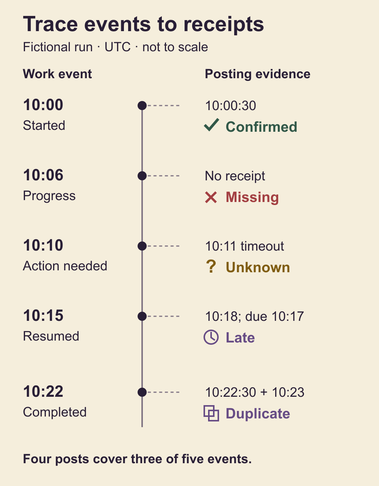

# Make AI goal progress visible with Slack notifications

You leave an AI-assisted task running and return to a quiet channel. The silence could mean steady progress, a decision waiting for you, a failed message or an executor that stopped. More frequent messages alone will not tell you which one happened.

Build a small notification contract before the run: which events deserve a message, where they go, what the owner needs to know and which evidence confirms posting. Keep expected events separate from send attempts. At the end, reconcile both against the work that actually happened.

The result is a record you can inspect, including its gaps. You should be able to answer: what finished, what is waiting, what needs a decision, and which of those changes reached the selected Slack destination?

## Choose events that change the owner's understanding

Use this method when work continues beyond a short conversation, crosses several issues or can pause for an owner decision. For a small task you are watching, a start acknowledgement and a final result may be enough. Extra progress machinery should earn its maintenance cost.

Before starting, name the outcome, permitted actions, reserved decisions, intended issue sequence and completion checks. Notification rules cannot make an unfinished task complete or authorize work outside that boundary.

Choose events from the work itself:

- **Goal and issue started:** execution actually began, with a named outcome and next checkpoint.
- **Progress:** a meaningful result, a changed expectation or the agreed maximum silence interval while execution is active.
- **Action needed:** an unresolved decision or input now prevents authorized work from continuing.
- **Resumed:** the required answer or recovery is verified and work actually resumes.
- **Issue or goal completed:** its defined outcomes and checks are satisfied, with a useful result link.

Record the event time and a posting deadline. For example, you might choose a two-minute target for important state changes and at most 30 minutes without a successful update while actively running. These are operating choices for the run, not Slack guarantees. Preserve actual delays rather than enlarging the target after a miss.

A long build can need an update even when its state has not changed: say which verified check is still running, what will be inspected next and whether the owner needs to act. Do not manufacture progress or a new estimate to make the message interesting.

## Separate the sender, route, message and attention settings

Use an authorized bot identity for automated updates, then verify the sender identifier in the response or readback. A familiar display name is insufficient identity evidence. Do not silently send through the owner's personal account when the configured bot fails.

Choose the destination independently. Retain a placeholder such as [CHANNEL-ID] in reusable templates; bind it only in private run configuration. A channel, a direct message and a reply in an existing thread are different routes. Decide where important decisions will remain visible and how related progress messages are grouped.

Then write for the person receiving the update. A useful message states the changed result, current state, next checkpoint and any requested action. Link to the smallest authorized artifact that supports the claim. Keep secrets, private records, raw logs and unnecessary internal identifiers out of the message.

Finally, check attention preferences with the owner when device alerts matter. Slack lets people choose which messages trigger notifications, select desktop or mobile delivery and pause alerts on a schedule. A mention or a successful post does not establish that a phone displayed an alert. See [Slack's notification settings](https://slack.com/help/articles/201355156-Configure-your-Slack-notifications).

If a device alert needs verification, arrange a separately authorized test and record the owner's observation for that test. One reported alert supplies no evidence of continuous future delivery. Do not change someone's notification preferences as a side effect of configuring progress messages.

## Prepare short messages before they are urgent

Write templates while the finish condition and decision boundaries are clear. Keep the route and owner placeholders unbound in the reusable copy.

A start message can say: "Started [OUTCOME]. First checkpoint: [CHECK]. Reserved decision: [DECISION OR NONE]." If the goal start and first issue start coincide, one message may cover both, provided its body actually explains both events.

For progress, use: "Finished [VERIFIED RESULT]. Working on [CURRENT STEP]. Next checkpoint: [CHECK]. Action needed: [NONE OR SPECIFIC ACTION]." Replace every placeholder before sending. A forecast belongs only when you have a basis for it; the next observable checkpoint is often more useful.

An action-needed message needs the exact decision, what is paused and what remains safe. "Choose [OPTION] so [NEXT STEP] can continue; [OTHER WORK] is preserved" is more useful than "blocked." Send it before yielding when possible, and retain its receipt or notification failure. If it cannot be delivered, preserve the pause and surface both the work blocker and the notification problem through the existing task conversation.

A resumed message should name the verified answer or recovery and the step that has restarted. An alert being sent, time passing or the owner opening Slack does not authorize resumption.

For completion, state what was verified, link to the actual result and identify any remaining limitation. A finished artifact with a failed notification is two states to report, not one combined success.

## Retain the attempt and the receipt

Give each logical event a stable local identifier. Before a send, save its event identifiers, dispatch time, intended destination and exact sanitized body or body hash. This makes an uncertain response easier to reconcile.

Keep attempts as separate rows. A definite failure, an unknown result and a confirmed post mean different things:

- **Failed:** evidence establishes that the attempt failed, such as an explicit rejection. Apply the authorized bounded recovery rule and retain the failure even if a later attempt succeeds.
- **Unknown:** the response was lost or timed out after dispatch. Slack may already contain the message. Read back the intended route and event marker within a bounded interval before considering another send.
- **Confirmed posting:** the response or actual message readback establishes the message, destination and sender. Save the evidence and posting time.

For Slack's chat.postMessage method, the successful response includes an ok value, channel and message timestamp identifier, ts. Inspect the returned message as well, because Slack may normalize its content. See the [method's response contract](https://docs.slack.dev/reference/methods/chat.postMessage/).

If readback finds the message after a timeout, amend that same attempt with the observed receipt and retain its original uncertainty. Do not invent a second send. If readback remains inconclusive, leave the attempt unknown and report the gap. An unsuccessful search alone does not prove that Slack never received it.

## Audit an illustrative run

Consider a fictional run that prepares a request-tracker export. All times and receipts below are invented teaching data in one declared timezone. They are not messages sent to Slack.

The work history contains five expected events: start at 10:00, progress at 10:06, action needed at 10:10, resumed at 10:15 and completion at 10:22. Each has a two-minute posting target. The executor yields at 10:13; a separate work record contains the required answer at 10:14.

The supplied attempt record shows:

- Start posted at 10:00:30.
- No attempt or receipt for the progress event.
- Action-needed dispatch at 10:11, followed by a timeout and unresolved outcome.
- Resumed posted at 10:18, after its 10:17 deadline.
- Completion posted twice, at 10:22:30 and 10:23.

Four delivered messages cover only three distinct expected events. The missing progress update stays missing. The action-needed attempt stays unknown, including whether it posted before the 10:13 yield. The resumed message is delivered but late. Completion has duplicate delivery. Counting receipts alone would hide those distinctions.

The answer at 10:14 can support the decision to resume if it satisfies the task's authority. It does not prove that the earlier alert reached anyone. Likewise, two completion messages do not compensate for a missing progress event.

These outcomes were checked with an offline synthetic coverage calculation. It sends nothing and evaluates only the supplied event history, active intervals and attempts. It does not prove real Slack delivery, recipient attention or the completeness of a real goal's history.

## Reconcile against the work, then close the record

Build the expected-event list from task and issue history, not from the receipt list. Compare the planned sequence with actual starts, completions, pauses, reopens, decisions and resumptions. Add legitimate unplanned events. Mark the audit partial when those source records or active intervals cannot be reconstructed.

Check every expected event for a verified post, delay against its original deadline, correct route and sender, and duplicate sends. For an action-needed event that suspended work, check delivery before the recorded yield. Preserve unknown attempts and any recovered failures.

Check maximum silence only inside observed active intervals. Do not classify a quiet period as offline merely because no message arrived. Conversely, do not count a documented owner-decision pause as active execution. Retain the interval boundaries and their evidence.

The fictional audit needs reconciliation, not a clean score. Look for the ambiguous action-needed message before any resend. If you send a useful catch-up update, label it retrospective and keep its real posting time. Preserve the original missing or late result; do not backdate it. Record the duplicate without deleting provider messages merely to improve the report.

## Keep runtime availability explicit

A written notification procedure runs only while an executor can follow it. An offline checker inspects saved input. Neither can alert you from a stopped process or an unavailable host.

If you need independent detection of a silent executor, that is a separate watchdog design with its own runtime, state signal, authorization, failure handling and notification route. Do not describe a periodic message rule as that system.

The smallest useful setup is one authorized sender and route, a short event table, exact action-needed and completion templates, and retained attempts and receipts. For a longer goal, add the bounded-silence rule and a final comparison with work history. Before relying on it, use the companion's synthetic audit to confirm that a missing event and an ambiguous send stay visible even when the work itself finishes.
