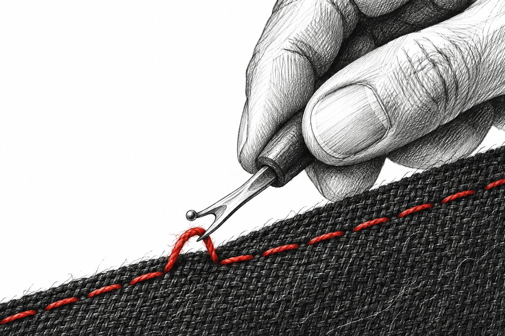
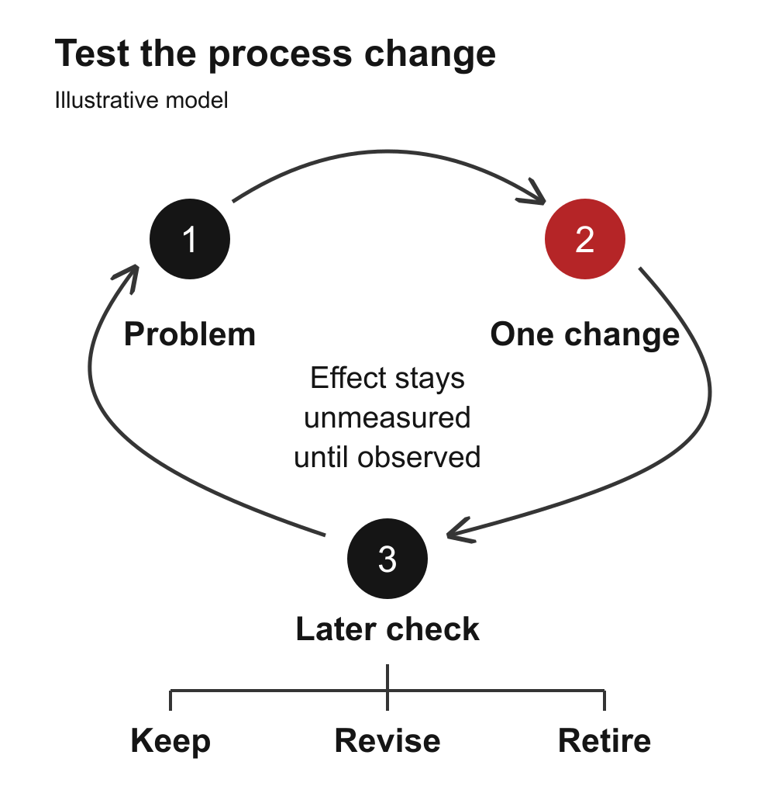

# Use reviews and retrospectives to improve the process

A sprint can finish with every issue closed and still leave you unsure what to change next. Perhaps the result works, but the scope grew midway through. Perhaps an AI agent completed its code, then waited hours for a decision nobody knew was pending. A green board hides both questions.

You need a short record that connects the intended outcome, what actually happened, and one working practice worth testing. This guide shows how to build that record without turning every delivery problem into a new ceremony.

The useful result is a small improvement experiment with an owner, a check and a later decision. Saving new instructions is one milestone. Evidence that those instructions helped comes later.

## Give the product review and retrospective different jobs

Start with two questions:

- **Product review:** What can someone actually do now, what evidence supports that result, and what should the product do next?
- **Retrospective:** What about the way you prepared, built, checked and coordinated the work should change?

The [Scrum Guide](https://scrumguides.org/scrum-guide.html#sprint-review) distinguishes inspecting the product outcome from improving how the team works. The lightweight record below is an adaptation for a small team or a builder working with agents. It is not a claim that a few notes implement the full Scrum framework.

You can discuss both in one sitting. Give them separate conclusions. A working export may justify the next product step while its repeated approval waits justify a process experiment. Neither conclusion erases the other.

Use this method after a completed increment, a difficult handoff or a repeated interruption. You do not need to wait for a formal sprint boundary. For a tiny reversible change with no new learning, a short note may be enough.

## Reconstruct the comparison before discussing causes

Bring the preserved plan, the demonstrated result, issue history, correction records, known waiting intervals and the previous improvement log. Ask the people involved what helped and what made the work difficult. An agent can organize those inputs, but it should not invent their experience.

Keep the comparison small enough to inspect:

- **Opening scope:** What outcome and work were selected, and when was that snapshot saved?
- **Scope movement:** What was added, removed, split or redefined? Why, and who made the decision?
- **Actual result:** Which original obligations passed their checks? Which remain unfinished or have changed acceptance conditions?
- **Interruptions:** What stopped progress, what resumed it, and which intervals have timestamps?
- **Experience:** What did the owner or collaborators report, and what remains an interpretation?

If the first saved plan was written after work began, label it that way. Do not promote it into an exact opening commitment. If one large issue became three smaller ones, record the split instead of calling it three new outcomes.

Likewise, a higher issue count is not proof of higher productivity. Different scope, granularity and acceptance conditions can change the count. Keep points as planning estimates, without turning them into measured hours.

## Work through a fictional sprint

Consider an illustrative shared request tracker. Every number in this example is fictional; this is a document exercise, not a measured project result.

At planning close, the builder saved six items: create a request, assign an owner, update status, filter requests, export the list and recover a failed save. Two items were added during the sprint: an export permission rule discovered during review, and a new bulk-edit convenience feature requested afterward. Nothing was removed or split.

At the evidence cutoff, five of the six original items and both additions passed their checks. The export itself remained incomplete. Seven items were accepted out of eight in final scope, but the original six-item commitment was not completed. A permission rule passing does not make the unfinished export work.

The permission rule protects who can access exported information. Its discovery is a prompt to inspect preparation and retain the rule. The bulk edit is a deliberate scope choice. Do not label both additions a planning failure or quietly omit either from the record.

One work interval ran from Monday 09:00 to Tuesday 09:00, in UTC. The log marks a decision wait from Monday 13:00 to 17:00 and a check run from 17:00 to 18:00. These two intervals do not overlap.

That is 24 elapsed hours, including four recorded waiting hours and one recorded check hour. The remaining 19 hours are unclassified. They might include implementation, other waits, inactivity or correction. You cannot call them 19 coding hours, and you cannot turn the whole interval into three eight-hour workdays of effort. If intervals overlap in your real records, do not add them twice.

The fictional owner reports finding the decision request only on returning to the desk. That is testimony about friction. The timestamps establish a wait. The explanation that earlier preparation would have prevented it is still a hypothesis to test.

## Turn one problem into a bounded change

Write the chain before choosing a new tool: observed problem, plausible cause, proposed change, success evidence. This makes it easier to spot an unsupported leap.

One documented private retrospective followed this chain. Work packages repeatedly needed subdivision after an unattended run began. The owner reported returning to find work paused for decisions. A later written procedure required tracing the complete path to the promised outcome, anticipating known dependencies and subdivisions, and identifying owner decisions before launch. Routine subdivision could proceed within already authorized scope while material decisions stayed reserved.

That delivered a corrective procedure. It did not establish that later runs had fewer interruptions. The missing evidence was the next runs' preparation records, late subdivisions, reasons they were missed, and timestamped owner waits. The durable retrospective kept those effectiveness questions open after the procedure changed.

You can apply the same reasoning without adopting that whole procedure. In the fictional tracker example, try one change: before the next comparable unattended run, trace the outcome through its inputs, implementation, integration and final checks. Mark unresolved owner decisions and prepare foreseeable subdivisions within the agreed authority. A material change still needs its real decision maker.

## Define how you will judge the experiment

Give the change a stable ID such as R1 and record:

- **Hypothesis:** Preparing the complete delivery path will reduce avoidable decision waits caused by known missing prerequisites.
- **Owner:** The builder prepares the record; the product owner resolves reserved choices.
- **Checkpoint:** Review the next three comparable runs, or reassess after two weeks if fewer occur. These are illustrative bounds, not a universal target.
- **Observations:** Save the prelaunch preparation, every late subdivision, whether its cause was knowable at launch, and timestamped waits for owner decisions. State the population and missing records.
- **Success condition:** In all three runs, no avoidable pause is traced to a prerequisite that the preparation could reasonably have exposed. Preserve the original acceptance and safety checks.
- **Cost and stop rule:** Cap preparation at 15 minutes per run for this experiment. If it needs more, review the scope and method. Do not shorten necessary checks merely to meet the cap.

The fictional sprint supplies one four-hour decision wait. It does not establish an average waiting baseline or a trend. Three later runs can inform a local keep-or-revise decision, but they cannot establish a general causal productivity gain. If the next work is materially different, describe the difference rather than forcing a comparison.

## Save the record and start the next review with it

Keep the product result, scope comparison, owner experience, experiment and unknowns together in a dated record. Link the work evidence where authorized. Preserve the original account when later evidence arrives; add a dated follow-up rather than rewriting a proposal as if it had always been proven.

At the next review, open the previous action log first. Give each action an honest disposition: proposed, agreed, implemented but unmeasured, observed helpful within the stated sample, ineffective, deferred or retired. Say who adopted a change; an agent-generated recommendation is not a team decision.

Ask what the change cost as well as what it helped. If a duplicate checklist is maintained but never used to make a decision, simplify or retire it. Keep the verification, privacy and reliability obligations it was meant to support. Removing redundant paperwork does not authorize removing the underlying safeguard.

The companion provides a fillable retrospective record and improvement experiment log, plus the complete fictional sprint exercise. The documents remain separate from this article; you can also reproduce the fields above in your existing project notes. A hosted tool is unnecessary for this small record.

## Check that the record is useful

Before closing the discussion, verify that another reader can distinguish original scope from additions, accepted outcomes from closed issues, testimony from measurements, and a delivered process edit from evidence of its effect. Check the fictional example yourself: six original plus two added equals eight final items; five original plus two added equals seven accepted; 24 elapsed minus four waiting minus one checking leaves 19 unclassified hours.

Then find the next decision. There should be an owner, a checkpoint and a condition for keeping, revising or retiring the experiment. If the record ends with only “communicate better,” it has not yet given you something testable.

For the lightest useful version, save five lines: intended outcome, actual evidence, one observed friction, one change to try, and when to inspect its effect. Expand only when scope movement or competing explanations would otherwise be lost. A small record earns its place by helping you make the next decision.
