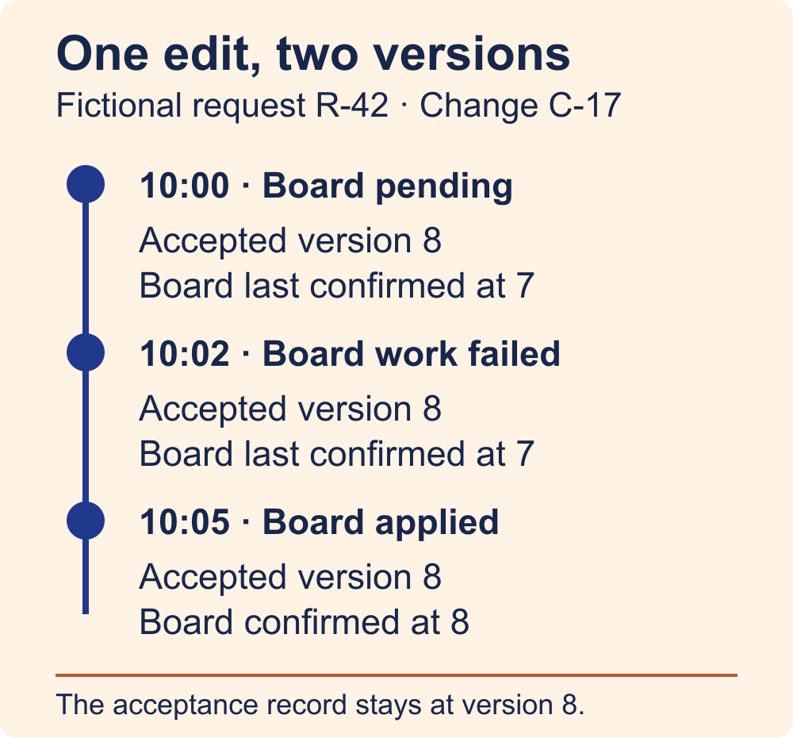

# Make the data model and API describe what is true

You change the title of a request and see a green “Updated” badge. The shared board still shows the old title. Did the save fail, or has the board simply fallen behind? A single success flag leaves you guessing, even when the system knows exactly what happened.

Before you build the endpoint, write down what the screen should be able to say at each point. By the end of this exercise, you will have a small contract that connects a submitted change, the version your service accepted, and the version a separate surface actually applied.

## Start with the questions on the screen

Use this method for a slice where a user acts in one place and needs to know what happened somewhere else. Bring the proposed write, the read screen, and a list of the work that can finish later. A single form that writes to one database and reads straight back from it may need only a saved version and clear error handling.

In this fictional request tracker, an editor changes the title of request `R-42` from “Draft agenda” to “Review agenda.” A separate shared board applies changes later. The editor wants answers to three questions.

- Did the service accept my edit? The service can answer once it commits the change.
- What title is the board known to have applied? A versioned acknowledgement from the board can answer.
- How current is this screen's information? The read response can say when its view was assembled and when its board evidence was last observed.

Decide what each answer means before assigning an icon or status label. An accepted edit and a delayed board are compatible facts. A stale screen can also display an accurate record of a past observation.

## Give each fact an owner and an identity

Use `R-42` for the request across reads and writes. Give this submission the stable client-generated change ID `C-17`, and an integer version that increases within `R-42`. Here the editor starts from version 7, and the service assigns version 8 to `C-17`. The request ID answers “which thing,” the change ID answers “which edit,” and the version answers “which revision.”

Keep these records as small as the slice permits.

- The request holds the current accepted title and version.
- The change records the accepted payload, the expected version, the assigned version and the acceptance time. Keep the accepted contents of an older change available even when a newer edit becomes current.
- A board work record names the accepted change and version it should apply. Its state can be `pending`, `failed` or `applied` when the service has the corresponding evidence. Use `unknown` in the read view when the evidence needed to classify it is absent.
- A board acknowledgement identifies the request and version it applied. Record when the service observed that acknowledgement. Its scope is board application, so leave claims about whether anyone saw the title out of the interface.

An acknowledgement for version 7 cannot finish `C-17`. The request and version must match before you attach downstream evidence to an edit. Keep acceptance and board evidence as separate fields even if the first UI shows them in one sentence.

## Define what the write promises

A client submits `C-17`, the new title and `expectedVersion: 7` for `R-42`. The server checks that the current version is still 7. In this example the write commits the accepted change, advances the request to 8, and stores the pending board work together. The response identifies `C-17`, version 8, and the recorded acceptance time.

If you expose the new change as its own HTTP resource, a `201 Created` response can describe that resource and point to it. Its body can say `acceptance: accepted` and `board: pending`. A `202 Accepted` response is suitable when the HTTP request has been accepted for processing but its processing has yet to finish. Choose the code for the promise of your endpoint, then use the fields to make the business meaning explicit. [HTTP Semantics, RFC 9110](https://www.rfc-editor.org/rfc/rfc9110.html#section-15.3.2).

The transaction covers the records in your database. The board is a separate action and may still be delayed after the transaction commits. Putting the intended work beside the accepted change keeps both local records together. This design still needs a worker and a way to observe the board's result. [PostgreSQL transaction tutorial](https://www.postgresql.org/docs/current/tutorial-transactions.html).

If another editor has already advanced `R-42` beyond version 7, return a conflict and ask the client to reload the current version before submitting a revised edit. The rejected edit has no accepted change or new board work. If the response times out, the client can say “Checking whether your edit saved” while it looks up the result for the same submission. A timeout alone leaves acceptance uncertain. Design the lookup or safe replay path before giving the user a retry button.

## Shape the read around one user question

For the editor, the useful read is “What changed, and where has that change landed?” A read projection is the response assembled for that question. Start with a response that carries the accepted request ID, change ID, version, title and time. Add the board work state, the last confirmed board version, the observation time, and the time the read was assembled. A single response makes it easier to compare these values from one coherent view.

At 10:00, `C-17` is accepted at version 8. The board work is pending and the last board acknowledgement is for version 7. Show “Saved as version 8. Board last confirmed at version 7.” Keep the accepted title available to the editor.

At 10:02, the worker records that the board update failed. The accepted title still belongs to version 8. Show “Saved. Board update failed.” The team can retry board work under its own policy while preserving the original accepted change.

At 10:05, the board acknowledges version 8 after a successful attempt. Show “Board confirmed version 8 at 10:05.” If a delayed read then arrives with a confirmed board version of 7, compare its snapshot order before replacing the screen. For reads of the same request, a monotonic view revision can prevent an older response from reversing a newer one. Reset that comparison when switching requests.

Freshness needs its own rule. A response assembled moments ago may still contain old board evidence. Pick a threshold only when the product needs a “current” claim, and base it on the age of the underlying observation. If confirmation is absent, show “Board version unknown.” If an old confirmation exists, say when it was last observed. Avoid guessing a cause from silence.

## Write the acceptance cases before wiring the badge

Walk the same identities through the service, storage and UI. For every case, name the source of the claim and the phrase the screen may use.

- The acceptance commit succeeds while the board is delayed. The read shows version 8 saved and version 7 last confirmed.
- The write conflicts with a newer accepted version. The editor keeps the proposed title and sees a reload action.
- The write response is lost. The screen shows uncertainty until lookup resolves the original submission.
- The board update fails. Version 8 stays accepted and the board failure stays visible.
- Acknowledgement for version 8 arrives. The board may now be shown as confirmed at that observation time.
- A stale response arrives afterward. The screen keeps the newer read, and any old evidence still carries its own timestamp.

The smallest useful version is a request ID, an accepted version, and one downstream result tied to that version. Start with a direct read when all the required facts can be fetched coherently in one place. Add a separate projection or freshness threshold when the screen needs it. Before shipping the slice, ask a teammate to explain each badge using the exact record that justifies it. Any badge without that record is a contract to fix.
