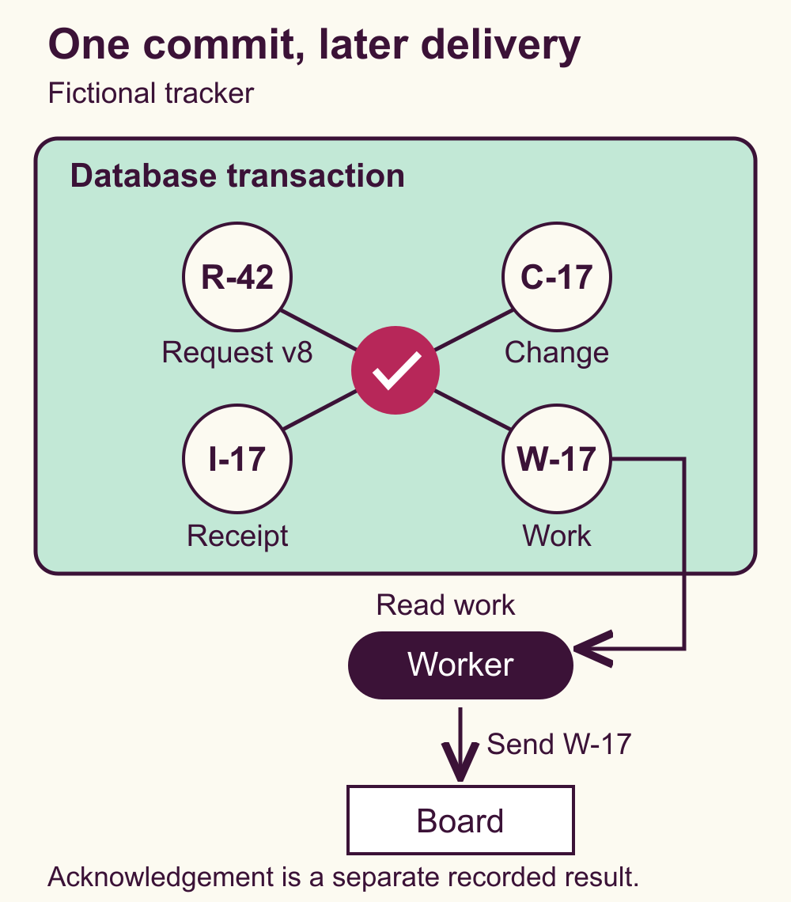

# Build backend writes that survive retries and partial failure

Your client sends a write. The database commits, but the connection drops before the response arrives. The client tries again. If each attempt creates a new operation, one click can produce two changes and two pieces of downstream work.

A timeout leaves the caller uncertain about the result. Build a write path that can answer the next attempt from a durable record, reject incompatible reuse, and recover unfinished work. This guide shows how to define those behaviors and turn them into a failure-case test matrix.

The running example is a fictional shared request tracker. You will revise request `R-42` from version 7 to version 8, then arrange for its shared board to receive that change. The identifiers, policies and expected results below are illustrative. Use them as a design exercise and adapt them to your own API.

## Begin with the operation you want to preserve

Before implementing retries, describe one user intention in a sentence. Here, a person wants to change the title of `R-42` to `Repair the lamp`, based on version 7. All transport attempts for that intention carry the same idempotency key, `I-17`.

An idempotency key lets the service recognize repeated submissions of one logical operation. A separate resource version protects against overwriting somebody else's edit. You need both when a retry can arrive after another person has changed the same record.

Write down the authoritative result, the operation identity, the version precondition and the downstream obligation. For this example, acceptance produces change `C-17`, request version 8 and board work `W-17`. The board can still show version 7 while that work is pending.

This design helps when clients retry, users have several tabs open, or a committed change must trigger later work. A small application with one database can use it too. You need neither a message broker nor several services to make the failure boundaries explicit.

## Give the key a precise scope

Choose the namespace where a key must be unique. The fictional API uses the authenticated workspace, the operation type and the client key together. All three fields are required. The server derives the workspace from verified access context and checks permission on every attempt, including replay.

Bind that identity to the normalized command. Include the target request, intended title and expected version. Compare the meaningful fields consistently, whether you store them directly or store a fingerprint. Define normalization deliberately so that equivalent encodings do not cause accidental conflicts, and distinct edits remain distinguishable.

The service follows three rules while its receipt is retained.

- A new scoped key can attempt the command.
- The same scoped key and matching command return the recorded outcome.
- The same scoped key with a different command returns a key-reuse conflict and changes nothing.

Save the accepted result needed for a replay, including the change ID and accepted version. That result describes the original acceptance. A separate read supplies the request's current state if later edits have occurred.

Define retention and late-retry behavior alongside the client retry budget. Deleting a receipt can make an old attempt look new. An expiry policy needs a deliberate response to that possibility. For example, an API can reject expired operation identities instead of accepting them again. The example here assumes the receipt is still retained.

## Make competing attempts meet in the database

A check in application memory cannot coordinate two service processes. If both ask whether `I-17` exists before either inserts it, both can proceed. Protect the receipt namespace with a database uniqueness constraint and implement a claim protocol that resolves concurrent attempts.

In PostgreSQL, a unique constraint can cover a group of columns. Use required columns for every part of the key. Specify what a competing insert does, when it waits, and how it reloads the winner's committed result. These behaviors need tests against your chosen isolation level. [PostgreSQL constraints](https://www.postgresql.org/docs/current/ddl-constraints.html)

For this example, the first attempt claims the receipt key inside the transaction. A simultaneous matching attempt waits for that transaction to resolve, then reloads and compares its receipt. If the first transaction rolls back, the waiting attempt may claim the key and try the operation itself. Keep the wait bounded and return a retryable pending or unavailable result if it exceeds your request budget.

Resolve resource concurrency separately. Either lock the target row and check its version inside the transaction, or use a conditional update whose condition includes the expected version. In both approaches, a successful edit advances version 7 to 8. A different command still expecting 7 must receive a stale-version conflict.

Choose that strategy using the database's documented concurrency behavior. PostgreSQL rechecks an update's condition against a concurrently updated row after waiting for its writer. An earlier application read alone cannot provide that protection. [PostgreSQL transaction isolation](https://www.postgresql.org/docs/current/transaction-iso.html)

Look up a retained receipt before evaluating the current resource version. Otherwise a safe retry of an accepted command can become a false stale-version error just because its own first attempt advanced the version.

## Commit the change and its recovery record together

For a new, authorized command, make one local transaction cover the records that define acceptance.

1. Claim the scoped key or load its recorded outcome using the concurrency protocol.
2. For a newly claimed key, check the request's version and other business preconditions.
3. Persist the title and version 8, plus change `C-17`.
4. Insert durable board work `W-17`, tied to `C-17` and version 8.
5. Record the accepted outcome for `I-17`, then commit before returning success.

The diagram shows the accepted branch. The duplicate and conflict branches return before creating another change or work item.

If any required insert fails before commit, roll back that attempt's records. A local database transaction provides the all-or-nothing grouping for these changes. The remote board participates through later work. [PostgreSQL transactions](https://www.postgresql.org/docs/current/tutorial-transactions.html)

Decide how rejected commands behave too. In this fictional contract, a valid new command with a stale expected version commits a conflict receipt, with no title change, new accepted change or work item. Its retries reproduce that conflict. A corrected edit uses a fresh key. Invalid or unauthorized requests leave no operation receipt. These are explicit API choices that your tests must match.

If the connection fails during commit, the service may also be uncertain whether acceptance persisted. Preserve the key and command, then resolve the outcome through the same receipt protocol. A fresh key would create another operation while the first remains unresolved.

## Recover the work after acceptance

The work row is an outbox entry, a durable instruction to perform the next step. A worker can scan eligible rows, claim one with a bounded lease, and retry unfinished work after restart. Define attempt limits, delays and the route for work that requires intervention.

Saving the accepted change and its outbox entry in one transaction closes the gap where the change commits but the instruction to notify another system disappears. The consumer still needs protection from duplicate delivery. [AWS transactional outbox guidance](https://docs.aws.amazon.com/prescriptive-guidance/latest/cloud-design-patterns/transactional-outbox.html)

Consider a worker that sends `W-17` and crashes before recording the board's acknowledgement. Its replacement will encounter unfinished work and may send it again. Give the board a stable event identity and require it to deduplicate application of that event within its own transaction. For a versioned board view, also define how it handles an older version arriving after a newer one.

A downstream system that cannot deduplicate or expose a result for reconciliation leaves a remaining ambiguity. Record that limit in the product contract. For an irreversible external action, investigate the destination's own idempotency or reconciliation support before enabling automatic retries.

Only record board completion when the acknowledgement matches the relevant work and version. A successful local save can coexist with pending or failed board work. That distinction lets recovery continue without submitting the original title edit again.

## Check persistent state after each failure

Write expected records before writing test assertions. Inspect the database through a fresh connection after the transaction resolves, then check downstream state separately.

Begin each independent case with `R-42` at version 7 and no receipts or work for the test keys. Include at least these cases in your implementation suite.

- Accept `I-17` once. Expect one change, one retained acceptance receipt, one work item and version 8.
- Lose the response after commit and retry `I-17` unchanged. Expect the same `C-17`, version 8 and `W-17`, with no additional records.
- Reuse `I-17` with another title. Expect a key-reuse conflict and the original records unchanged.
- Submit two identical attempts concurrently. Expect one accepted operation and a replay of it after the wait resolves.
- Race two different keys against version 7. Expect one acceptance and one stale-version conflict receipt, with one accepted change and one work item.
- Force a required work insert to fail before commit. Expect version 7 and zero records from that attempt, including its receipt. A retry can then succeed.
- Restart the worker before sending, then after sending but before acknowledgement is saved. Expect durable work to remain recoverable and duplicate delivery to leave one downstream application when deduplication is supported.

The companion worksheet expands these cases into a fillable design checklist and expected-state matrix. Its worked exercise follows acceptance, a matching retry and a conflicting retry using the same fabricated identifiers. The example is an author walkthrough. Run the fault injections and restart checks against your implementation before claiming those guarantees.

## Start with the smallest complete path

For one database, start with one operation type, a unique receipt key, a version check, a local transaction and a worker that reads a durable work table. Keep the accepted result small enough to replay and the pending work easy to inspect.

If the operation has no required downstream effect, omit the worker and outbox. Keep the retry and conflict rules. Add a broker when your delivery needs justify it, with duplicate and ordering behavior still defined at the consumer.

You have a usable design when another engineer can explain the stored result of a retry, locate every record after rollback, identify the winner of a concurrent edit, and recover committed work after restart. Carry those outcomes into the tests and the user-visible states of the feature.
