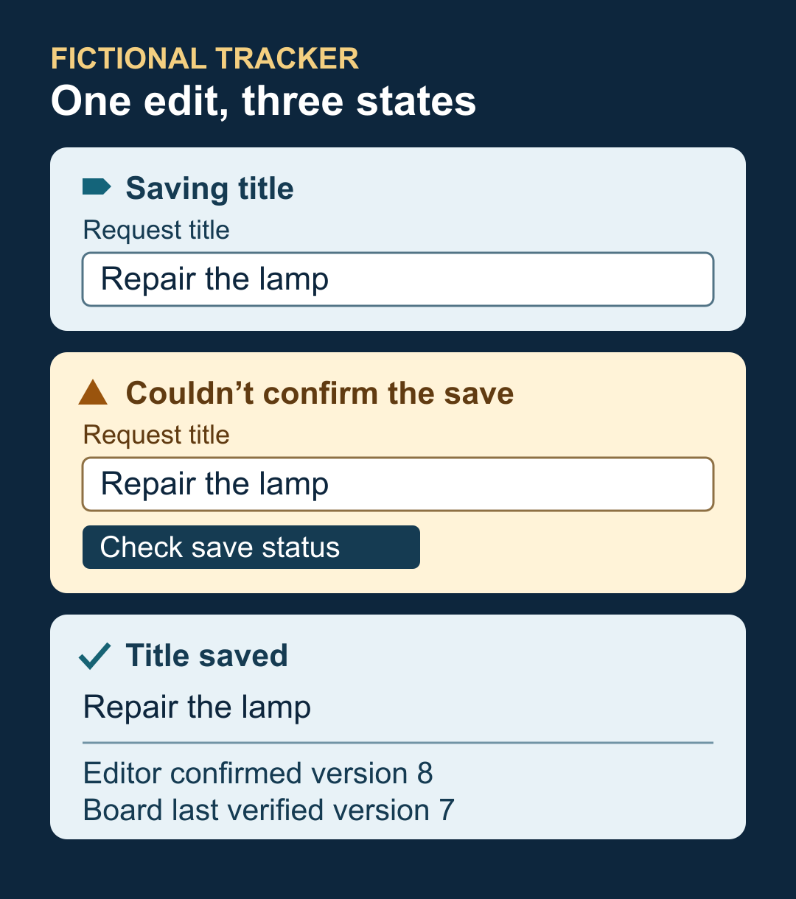

# Build a frontend that tells users what actually happened

Someone changes a request title and presses Save. The connection drops before the response arrives. The field still shows the new title, but the person needs to know whether the server saved it and what they can safely do next.

Start with one interaction and write down what the interface can confirm at each step. Connect each message to an actual signal. You can then use a small state matrix to design the screen and test it against slow, missing and out-of-order responses.

## Start with the facts behind the screen

Pick a write that people care about and gather the contract for it. Identify the record being edited, what a successful write response confirms, how a read identifies the record and its version, and how a client checks an uncertain write. If another view updates independently, find out what that view can verify for itself.

In the fictional request tracker used here, request R-42 starts at version 7. A user changes its title to “Repair the lamp.” The service can confirm that edit as version 8. A shared board reads independently and can still show version 7. The edit also has a stable operation key so the editor can check its outcome after a lost response.

Track three things separately.

- **Draft.** Keep the text the person entered in the form. It can change before submission.
- **Write outcome.** Keep the submitted fields and operation key together. Use the matching acceptance or rejection to settle that operation.
- **Latest verified read.** Keep the record and version you have checked, along with whether the latest refresh succeeded. A view that reads independently needs its own verified result.

These can be a few fields in ordinary component or query state. A save can be confirmed while the latest read is unavailable. A current read can coexist with an edit still waiting for its response.

## Put evidence and an action behind each message

Use the specific thing that happened to decide the copy and the next action. A useful first pass covers these cases.

- **Loading.** The first read is in flight. Show “Loading request.” Keep any applicable navigation available.
- **Empty.** A valid current response confirms an empty list. Show “No requests yet” and offer “Create request” if the person can create one.
- **Saving.** The edit is submitted and awaiting a result. Show “Saving title” and prevent duplicate submission while keeping the draft visible.
- **Accepted.** A valid response matches the submitted operation and confirms version 8. Show “Title saved.” Keep the editor usable once the operation settles.
- **Rejected.** A matching response confirms a validation failure or conflict. Retain the draft. Explain the correction, or let the person review the newer version before submitting a changed edit.
- **Outcome unknown.** A timeout or unusable write response leaves the outcome unresolved. Show “Couldn’t confirm the save. Your edit is still here.” Offer “Check save status” when the service supports it.
- **Stale.** The latest refresh failed and an authorized earlier snapshot remains usable. Show it with “Last verified at 10:14. Refresh unavailable.” Offer “Refresh” where the client supports that action.
- **Unavailable.** The client has no usable verified snapshot. Show “Couldn’t load requests” and an available recovery action. A malformed response follows the applicable stale or unavailable path after validation fails.

Treat permissions and scope as part of the read contract. If authorization is gone or the user switched accounts, clear the old display where the contract requires it. A cached view is useful only while it remains eligible to be shown.

## Walk through one lost response

In the fictional tracker, the editor sends the title change and shows “Saving title.” The network drops. The input keeps “Repair the lamp,” and the message changes to “Couldn’t confirm the save. Your edit is still here.” Leave the exact submitted operation available for recovery even if the person types a new draft.

After reconnecting, the editor checks the operation and receives a matching acceptance at version 8. The title can now be called saved. A read started before the write then returns version 7. Keep the title at version 8 and leave the save confirmation in place.

The shared board still has its own last verified version 7. If the board cannot refresh, it can show that older title with its last verified time and “Refresh unavailable,” subject to the same eligibility rule. When it reads and validates version 8, it can show the new title and clear the freshness warning. The editor can report the board as updated only if it receives separate evidence of that update.

When the outcome is unknown, choose the recovery action the API can support. Prefer a status lookup if the server exposes one. If the API guarantees replay for the same operation key and identical submitted fields, retrying that exact operation can resolve the uncertainty. If neither is available, explain the uncertainty and offer a supported read or reconciliation path. A current title may help a person decide what to do next, but a matching value alone may not identify which operation saved it.

## Keep older results from undoing newer information

A request that arrives last can contain older data. Check the response at the point where you apply it.

1. Validate its shape and confirm it belongs to the active account, list or record.
2. Compare the server version with the latest verified state for that same scope. In the tracker, a valid write response includes the accepted title and its version. That version can serve as the lower bound for subsequent title reads.
3. Keep the newer verified record if an older candidate arrives. If the same version contains contradictory fields that the contract says are stable, keep the trusted value, mark the read uncertain and request a new verified result.
4. Apply a valid newer candidate to the read state. Settle the write separately with its matching result. A late acknowledgment for version 8 can confirm that operation even if a newer version 9 is already visible.

Use a request generation or cancellation when a person changes filters, records or accounts. This helps discard obsolete work. A request generation answers which request still belongs to the current screen. A server version answers which result is newer within that scope. When your API lacks a comparable version, use the guarantees it actually provides and be explicit about whether a follow-up read can confirm freshness.

## Make the status usable while people work

Put the status near the form or list it describes. Keep the text visible and use named visual roles for ordinary progress, warnings and errors. A change of theme should leave the wording and meaning intact. Check the chosen colors and layout again when the theme changes.

For a web form, keep a persistent status region for routine updates such as saving and completion. A region with the ARIA status role can present a polite announcement without moving focus. Update its text when the meaningful state changes. Repeated polls with the same result should leave that text alone. Verify the announcements with a screen reader for the browser combinations you support. [W3C guidance on status messages](https://www.w3.org/WAI/WCAG22/Understanding/status-messages.html)

Give the field a visible label, connect specific errors to their controls, and make the recovery action keyboard reachable. Keep a visible focus indicator and preserve focus during background updates. For a failed submission that needs correction, use a deliberate focus step when it helps people find the errors. At a narrow width, let status text wrap and actions move below it so both remain available. Test the actual layout with long text, keyboard navigation and zoom. [W3C guidance on visible focus](https://www.w3.org/WAI/WCAG22/Understanding/focus-visible.html) and [reflow](https://www.w3.org/WAI/WCAG22/Understanding/reflow.html)

For the shared board, apply the same evidence rules with a simpler interface. It can automatically refresh and show “Last verified at 10:14” or “Refreshing” without presenting editor controls. After restart, revalidate a cached record’s scope and eligibility before displaying it. A saved snapshot can support a dated display if the contract permits it. A fresh board read supplies the evidence needed for a current one.

## Test the messages with a controlled sequence

Use a fixture with deliberate responses. Drive the interaction with the keyboard, check which message is visible and which control has focus, and record the versions shown in both views. The fictional sequence above is a worked design example. Run these checks against your implementation.

- Let one edit succeed normally. Check the title, version, available action and completion announcement.
- Drop the write response. Verify that the draft survives and that the recovery action resolves the same submitted edit.
- Deliver version 7 after version 8 is confirmed. Verify that version 8 stays visible and that the ignored result produces no success announcement.
- Return a valid empty list, an unavailable response and malformed data. Verify that each gets the right message and that eligible older data is labeled.
- Restore the editor connection before the board refreshes. Check that each view describes its own evidence. Repeat at a phone width with long titles and keyboard focus visible.

The smallest useful version is one edit, a matching write result, a guarded read and a useful recovery action. Add a dated retained view when it helps people continue safely. Use the same state matrix to review more interactions as they become important.
