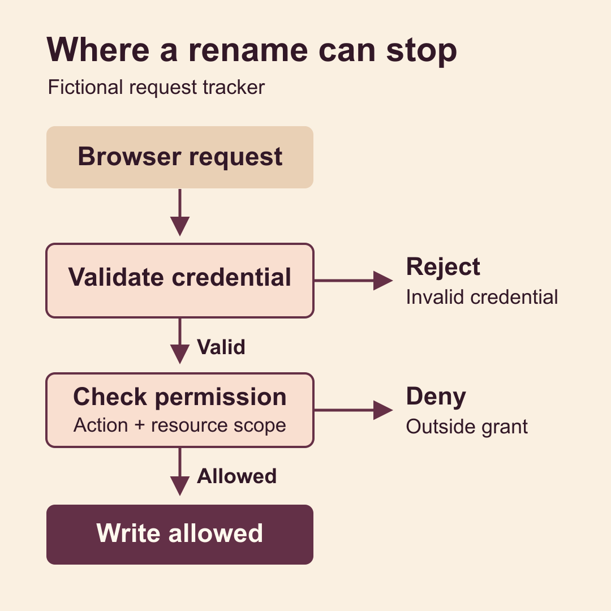

# Separate sign-in from permission to act

A user signs in and opens a request they can edit. Then they change the request ID in the URL and try the same edit on another team's request. The sign-in is still valid. The answer to the edit can change.

Pick one protected action and trace it from the browser to the data write. Write down what proves the caller's identity, what grants permission for this action, and what you can observe when either check fails. You will have a small test matrix that can catch a successful login masking a broken permission check.

## Map the three decisions

Start with the browser, the credential your server receives, the protected action, and the record that action touches. Identify where membership and roles come from. If you are working from an early design, write these down as assumptions to check.

1. **Browser sign-in.** The user signs in through the identity provider. Your application establishes a session or obtains the credential its server expects. A signed-in browser can show the user's identity and the right navigation.
2. **Request validation.** The server verifies the credential for this request and produces a trusted identity for the application. It rejects missing, invalid, expired, or unsuitable credentials at this boundary.
3. **Permission to act.** The application checks whether that identity can perform this operation on this resource now. Tenant, membership, role, and resource rules can all affect the answer.

You might hold a server-side session behind an opaque cookie or have an API receive a provider-issued access token. A server-side session can make invalidation straightforward when the server controls the session store. A self-contained access token can be verified locally, but a valid signature and expiry alone tell you little about whether a project membership changed a moment ago. Choose the session model for your application and make the permission rule explicit either way.

For a signed token, use a supported verifier configured for the credential type your endpoint accepts. Verify the signature with trusted issuer keys and an allowed algorithm, plus the issuer, intended recipient, time bounds, and other checks specified for that credential. Read the provider's contract for refresh and key rotation. An OpenID Connect ID token tells the client about sign-in. An API that expects an access token should reject an ID token presented in its place. Apply the validation rules for your actual token profile. [OpenID Connect Core](https://openid.net/specs/openid-connect-core-1_0.html#IDToken) and [JWT access-token validation](https://www.rfc-editor.org/rfc/rfc9068.html#section-4).

## Put the resource check where the write happens

In a fictional shared request tracker, an editor in Workshop A can rename requests in Workshop A. A viewer in that workshop can read them. A signed-in user with no membership has neither permission. The same editor has no role in Workshop B.

For a rename, the server starts with the verified caller. It maps that identity to an application account, using a stable identifier under its issuer when the provider supports that mapping. It resolves active membership and the role for the target workshop. It reads or updates the request within the allowed workshop scope. It only commits the rename if the role permits the action and the request belongs to that scope. The workshop and request values supplied by the browser identify what the caller wants to access. They are inputs to check.

Put the final decision in the server path that owns the operation. A common failure is checking membership in Workshop A and then using an unscoped request ID in the write. Keep the granted scope in the data operation itself. If membership can be revoked during a request, define the point by which revocation must take effect and choose transaction or concurrency controls that enforce it. Filtering buttons and links in the browser makes the product easier to use. The same rule must still apply to a direct request to the server. [OWASP authorization guidance](https://cheatsheetseries.owasp.org/cheatsheets/Authorization_Cheat_Sheet.html).

An application database is a practical place to start if users frequently join or leave workspaces or hold different roles across them. Signed roles or scopes can be useful when the provider owns those grants and their freshness meets your requirements. Document how long a changed grant could still be accepted. A coarse scope such as permission to edit requests may still need a check that the specific request belongs to the permitted workshop. If authority cannot be resolved, keep the operation blocked and distinguish service unavailability from a known denial.

## Try one allowed edit and three ways to deny it

Choose an isolated environment, two fictional workshops, one request in each, and an editor test identity in Workshop A. Add a second identity with a valid login and no workshop membership. Make sure you can inspect the target record through an authorized test read or a test database assertion. Start from a recorded title or version so the exercise can detect an unintended write.

1. **Allowed edit.** Sign in as the editor and rename the Workshop A request using the normal browser flow. Verify the exact new title through a scoped read. Capture the changed version or the expected test record so you can tell a real write from a success screen.
2. **Valid sign-in, missing membership.** Use the second identity and send the same edit for the Workshop A request. Verify that request validation succeeds and the application refuses the action. Check that the title and version stay unchanged and any expected downstream event was absent.
3. **Valid membership, wrong resource.** Return to the editor and use the Workshop B request ID. Test the direct write route even if the browser hides the record. Verify the denial and confirm through an authorized test read that Workshop B's request was untouched.
4. **Expired or invalid credential.** Use the provider's supported test route or an isolated verifier fixture for expiry. Verify that the server rejects the credential and no protected operation happens. If the browser refreshes credentials automatically, distinguish the rejected request from a later request made with a fresh credential.

Choose the public response deliberately. For an HTTP API, 401 fits missing or invalid authentication credentials, with the applicable challenge. A 403 can express a known permission denial. Use a consistent 404 policy where revealing a resource's existence would be a leak. The response is one observation. The unchanged record and absence of an unintended side effect tell you whether the operation was actually blocked. [HTTP semantics for 401, 403 and 404](https://www.rfc-editor.org/rfc/rfc9110.html#name-client-error-4xx).

## Check the integration with the real provider

Synthetic tests are good for wrong signatures, exact clock boundaries and role combinations. You control the inputs and can rerun the same case quickly. Keep those tests. They cannot show what credential your deployed browser actually sends or whether the configured provider, callback and server agree on the session profile.

In an authorized test environment, go through the actual provider sign-in and make the protected request from the browser. Check that the verified identity maps to the intended test account. Then exercise a valid provider session with inadequate application permission. These two rows tell you something different from a provider login screenshot. Use controlled tests where the provider cannot safely produce a malformed or expired credential. Label which rows used the actual provider and which used fixtures.

Record the environment, build, time, test case, and the decision each boundary returned. Use named test identities or a sanitized correlation reference. Record the status and the affected record's before and after state where safe. Keep credentials, cookie values, raw claims, provider secrets, and identifiable user records out of screenshots, logs and shared notes. The tracker here is fictional. These are expected checks to perform against your integration.

## Test what happens when access is removed

Remove the editor's Workshop A grant in the test environment. Keep the browser signed in and try the next rename within your documented revocation window. The permission check should deny the operation by that deadline. Test both a new session and a session issued before the grant changed.

When removing an account altogether, define who disables the application account, who revokes provider sessions where needed, and how other access routes are disabled. Confirm that local permission is withdrawn even if a browser still presents an otherwise valid credential. Where tokens or grants can remain active until a deadline, record that limit and test it. Handle profile or content deletion according to the product's separate retention rules.

For a first pass, use one write route, one allowed action, and the three denial rows. Keep a simple matrix of the input at each boundary, the expected decision and the record you will check. Add roles, resource levels and revocation cases as the product needs them. You are done with this pass when you can show where each request stopped and whether the target record changed.
