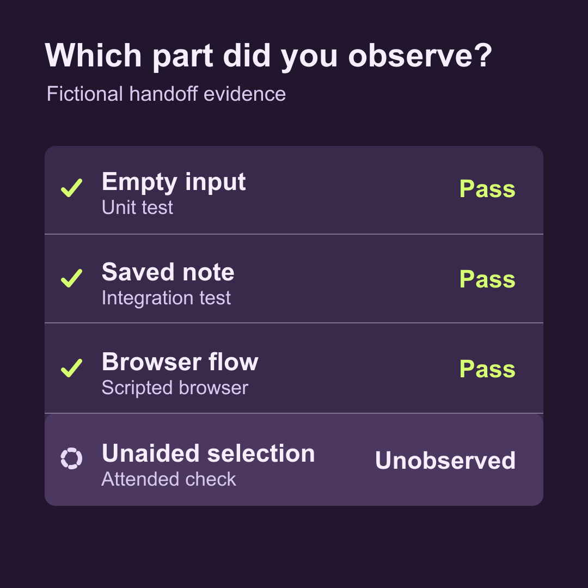

# Build an evidence trail from requirement to working experience

A test report says the build passed. Your client asks whether someone could pick the right request and submit a handoff without being told which control to use. To answer that, you need to know who took the action, what they saw, and which build they used.

Choose one promised experience and give each part of it a check with an observable result. At review, you'll be able to say exactly what worked, what failed, and what still needs to be seen.

## Turn a requirement into observable checks

Bring the requirement, the intended actor, a candidate build, an environment and a way to observe the result. Agree on the action before writing the checks. If you are still deciding what success looks like, write that uncertainty into the requirement.

Here is a fictional request tracker. A shift lead should find the open request called “Replace shelf label,” submit a note from its detail view, and see confirmation for that same request. The next lead should be able to reopen the request and read the note.

Break that promise into small observations. Finding the request unaided, writing the note against the right record, displaying accurate confirmation, and reopening the saved note are four separate observations. Each can fail independently. Give each a short ID. Write what counts as a pass and name one observation that would make it fail.

For the unaided action, the instruction could be “Leave the next shift a note about the missing shelf label.” The observer records whether the lead opens the intended request and selects the handoff control before any coaching. If the facilitator points to the button, record the assisted action. It can help diagnose a problem while leaving the unaided check unresolved.

## Use the lowest layer that can answer each question

A unit test can show that a note with only whitespace is rejected. An integration test can show that a valid note is saved against the requested record and remains there after a fresh read. A scripted end-to-end check can drive the actual test browser, submit the note and observe the confirmation and reopened note. Run useful negative cases too, such as choosing an unavailable request or opening a neighboring record.

Give each layer a job. Fast checks isolate a problem and are cheap to rerun. A browser check covers the path through several components and catches issues visible in the interface. Its script already knows which request and control to pick. If your promise includes someone finding those controls unaided, observe that action separately. For browser checks, assert visible behavior the user relies on, such as the confirmation text and the note shown when they reopen the request. [Playwright guidance on user-visible behavior](https://playwright.dev/docs/best-practices#test-user-visible-behavior).

## Review a bundle with a missing observation

Imagine the example bundle contains a passing validator test, a passing write-and-reopen integration test and a passing scripted browser run. All three reference the same candidate and the same request. The browser recording shows the correct confirmation and reopened note. The script selected the control itself. There is no recording or observer note of a shift lead selecting it unaided.

Use the bundle to make a bounded statement. “In the test build, the scripted browser flow submitted a note and the note reappeared on the intended request after reopening.” Mark the unaided action as **unobserved**. If that action was part of the acceptance requirement, the full promise remains open. A reviewer can still accept the narrower software result and identify what would close the open row.

For the follow-up, use the same candidate and a fresh test request. Give a test lead the task without naming the controls. Record who acted, the browser and build, the task wording, the selected request, any help given, and what the lead actually saw. One observed attempt supports a statement about that attempt. Claims about other people, devices or environments need their own evidence.

## Label what you ran and who decided

A **simulation** uses controlled inputs or substitutes for part of the system. It is useful for repeatable faults and cases that are expensive or unsafe to exercise directly. Record the substitutions and what was actually observed.

A **rehearsal** practices the run and catches setup or capture gaps. Keep its outputs labeled. If the next run uses a different candidate or fresh data, bind the new result to that run.

An **attended check** records a named role taking an action and an observer seeing the result in a known environment. Record whether the action was assisted and whether the data or participant was representative. An attended check can use fictional records, and a participant can be a teammate. Describe the scope in the result.

**Owner acceptance** is a decision about the evidence and remaining limits. Record the decision maker, the date, the candidate and the exact claim accepted. An automated test summary can support the decision. Record the decision as pending until the authorized person makes it.

## Make each result easy to check later

Keep a compact acceptance matrix with five pieces of information for each row.

1. **Requirement and action.** Write the observable outcome and who or what must perform the action.
2. **Check and failure condition.** Name the environment, the starting state and what would disprove the expected result.
3. **Evidence.** Link directly to the test result, recording, or observation note. Tie the item to the candidate, run and affected record. Keep unrelated private data out of the artifact.
4. **Disposition.** Mark each row as pass, fail, blocked, unobserved or not applicable and give the reason. A failed check produced an observed result that violated the expected condition. A blocked check could not reach that assertion. A missing observation stays unobserved. Use not applicable for an explicit scope exclusion.
5. **Decision or next action.** Keep the exact accepted claim, or name the missing observation and who will collect it.

If the evidence comes from several sources, check that they refer to the same build and instance of the action. A screenshot of a confirmation in one run and a stored note from another can each be valid without proving the same journey. Preserve the failed and partial runs with their original statuses. If you rerun after a fix, link the later result and record which version it tested.

Finish with the test environment's cleanup. List the test data and temporary resources you used, who owns each one, and how you checked that it was removed or returned to its expected state. Some evidence may need to be kept privately. Record what was retained and why. Unverified cleanup remains open even when the product check passed.

## Keep the first review small

Start with one requirement, one run ID and a few rows. A single table with direct evidence links and a dated decision can cover a small, reversible change. Add a separate evidence index when the artifacts span several tools or someone else needs to reconstruct the run.

Before sharing the result, ask another reviewer to trace one sentence from the decision back to the observation. They should be able to find the relevant check, candidate and actor without guessing. Leave a missing row visible and state the next observation needed. That makes the handoff usable even when the full experience is still awaiting acceptance.
