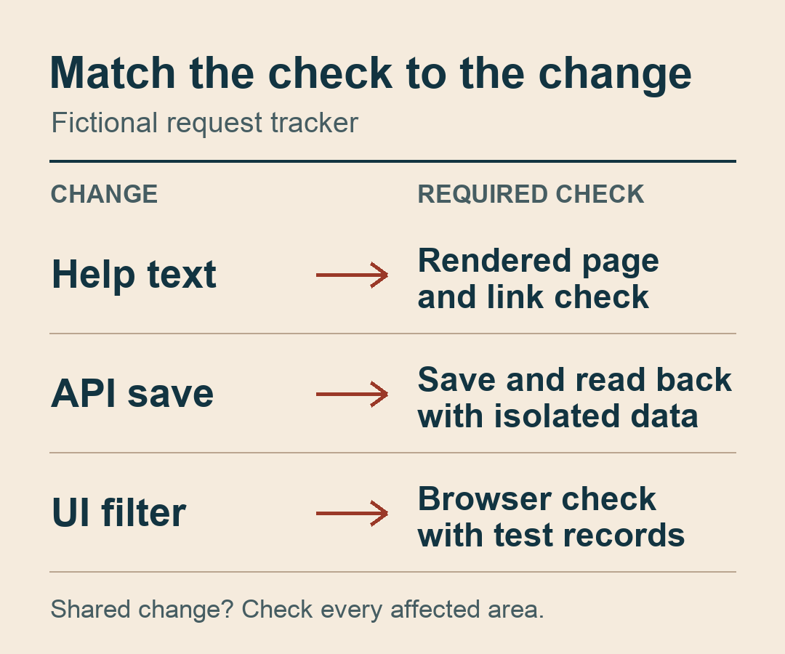

# Make CI and environments support the promise you are testing

You change how an app saves a request. The pull request turns green, but the only check that ran was a formatter. A week later, another pull request changes a help page and spends most of its CI time starting a database and a browser. Both runs can look healthy while giving you poor information about the change.

Start with a small table that connects each kind of change to the checks it needs, the conditions those checks depend on, and the evidence you expect to see. Then write down what your local, preview and release environments can each prove. Together, those two records let you tell whether a green run actually answers the question at hand.

## Start with the behavior that could change

Pick one real change. Name the behavior that might break and the smallest check that would catch that break. Use the changed files as a signal about which behavior may be affected. A file path alone rarely tells you everything. A change to a shared schema, lockfile or feature flag can affect several parts of an application even when the diff is one line.

Imagine a **fictional shared request tracker**. People update a request's status and use a filter to find open requests. A help-page edit needs a rendered page and link check if those pages ship with the app. A change to the API that saves a status needs a service check with an isolated database. A filter interaction change needs a browser check that moves through the UI and observes the right requests after reload. If the API response changes shape, select both sides of that boundary.

For each row, record four things you can verify during review.

- **Changed area.** Record relevant paths and shared inputs, such as a dependency lockfile or API schema.
- **Check.** Name the test or workflow and the failure it should catch. A service test that never reads the row back cannot show that an update persisted.
- **Prerequisites.** List the runtime, dependency install, test data and external services the check needs. Use a disposable database or synthetic records where those are sufficient.
- **Expected evidence.** Name the job or artifact you will open, the revision it covers and how you would recognize a pass. Include the fallback for an ambiguous diff.

Keep the first version small. If your app is small and the suite is fast, running all relevant checks on every code change may cost less than maintaining a selector. Add selective setup when you can explain a boundary and see real repeated work across runs. Start conservatively for shared or unknown changes. When you add a rule, compare its predicted checks with the actual jobs on a representative change before relying on it.

## Give each environment a question to answer

Environments can share an artifact and still offer different evidence. Write down which dependencies each environment uses, what you can observe there, and what you still need to check elsewhere.

**Local.** Use pinned tools and isolated inputs for fast feedback. In the tracker, a local service check can start with a fresh test database, save a new status, and read it back through the API. It shows what happened with those inputs on your machine. Hosted routing, deployed configuration and real provider behavior still need evidence from the environment where they matter.

**Preview.** Use preview when you need to see a change with hosted routing, a browser and test credentials together. In the tracker, open the preview URL directly, change a filter, reload, and verify the same results if persistence is part of the promise. Record whether identity, data or external delivery was simulated. A preview that uses a stubbed provider establishes what the application did around the stub.

**Release.** Identify the candidate and check the environment where you intend to use it. If you promote the same artifact, record its digest or an immutable artifact ID. If the platform rebuilds, record the new build identity and verify the output the platform actually serves. Pair the identity with the smallest live check that answers the release question. A Git revision identifies the source. It does not record which settings or build recipe produced every deployed file.

For each environment, keep an inventory of the runtime, install command, public configuration, credential references and expected checks. Record which three or four settings need to agree across environments and which deliberately differ, such as test data or external accounts. Keep the secret value in the approved secret store. Record its purpose, owning environment and how to check that it is available. Anything shipped to a browser should be treated as readable by its users. For container builds that genuinely need a credential, use the build system's secret mechanism and check that the output doesn't contain it. [Docker build secrets](https://docs.docker.com/build/building/secrets)

Pin the inputs you can control. For a Node project, that may mean recording the Node and package manager versions and using the committed lockfile with `npm ci`. If the dependency declaration and lockfile disagree, `npm ci` exits with an error. Treat that as an install failure and check which tests were able to run. [npm ci documentation](https://docs.npmjs.com/cli/commands/npm-ci/)

## Read the run against what you expected

Start with the event, revision and changed paths. Check what the workflow selected, then look at the execution of each check that matters. Give each of these outcomes its own disposition.

- **Passed.** The expected check ran for the intended revision and produced its success evidence.
- **Skipped.** A run exists, but a condition prevented a particular job or step from running. Record the condition and decide whether its absence fits the change.
- **Filtered.** The workflow was excluded before a run was created, for example by a branch or path filter. On GitHub Actions, a required check tied to a filtered workflow can stay pending. Verify the behavior before making a selectively triggered workflow a required check.
- **Missing.** You expected a result and have neither execution evidence nor an intentional exclusion. Check whether the run was triggered and whether it evaluated the intended diff. Hold the decision if the check is still required.
- **Failed.** Record the first failing test or prerequisite. A runner that could not set up a database and an assertion that found a bad write are different findings. A dependent job may then be skipped. Keep canceled checks visible too, especially if the next run covers a narrower change.

Check job and workflow conditions when a result is surprising. A green run summary alone cannot tell you whether the specific check you wanted executed. [GitHub Actions workflow syntax](https://docs.github.com/en/actions/reference/workflows-and-actions/workflow-syntax)

In the fictional tracker, suppose a backend change was expected to run an isolated-database check. The runner fails to start the database, so the save-and-read test never executes. Record the prerequisite failure and the missing application evidence. Restore the prerequisite, then collect the actual test results for that revision. A passing lint job from the same run does not resolve the gap.

## Try the worksheet on three changes

Take a help-text edit, a status-save change and a browser-filter change. Make a copy of this short worksheet for each change.

- **Change and affected behavior**
- **Expected check and prerequisites**
- **Environment and candidate identifier**
- **Observed result, disposition and next action**

Compare your prediction with a real run for one change when you have one. For the fictional examples above, the details are proposed checks and outcomes. They are useful for rehearsing the decision without claiming an application test took place.

Before handing off a release candidate, ask a second person to pick one required check and find its result. They should be able to tell what ran, where it ran, which candidate it tested and which important conditions remain unobserved. If they cannot, improve the record before adding more jobs.

The smallest useful version is one table with a row for a docs change, a row for an app change and a fallback for shared or unknown paths. Add one line for the candidate identity and one line for the least realistic dependency in the environment. That is enough to make the next green check easier to interpret.
