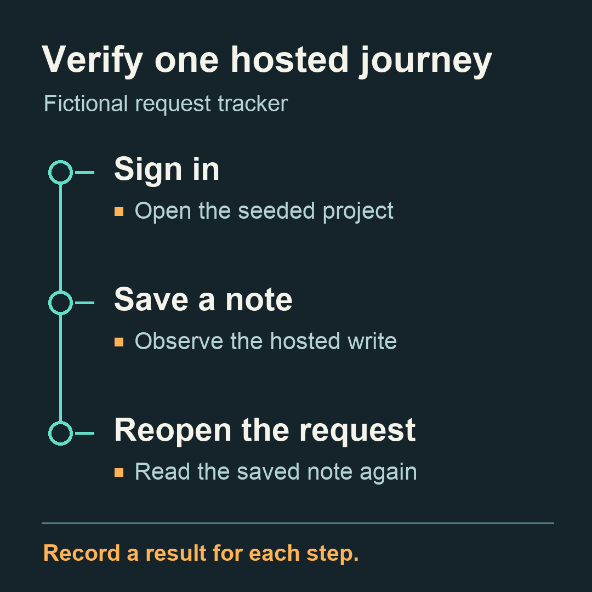

# Deploy a bounded environment and verify the real journey

You open a newly deployed app and sign in. The hosting dashboard is green, the first page loads, and the team wants to share the link. Then you try to save a request and the browser reports an error. The deployment worked well enough to reach the application. The journey you wanted to show still has an open question.

Before you deploy, write a small packet for one hosted journey. Specify the candidate, the resources and changes you have authority to use, the action a person needs to complete, and the evidence you expect at each boundary. Give the run an owner, a stop condition and a cleanup time. That lets someone else execute the same bounded check and reach the same decision from the record.

## Define the smallest hosted result worth checking

Start with one sentence about a user's outcome. In a **fictional request tracker**, a reviewer signs in, opens a seeded project, adds a note to a request, then reloads and sees that note. The example uses a designated reviewer account, a synthetic project, a disposable database, and a short review window. The exercise leaves real customer accounts, emails and public access outside the run.

Write down three separate milestones. First, you have deployable frontend and service artifacts with known identities. Second, the intended resources are running with their approved settings. Third, someone has actually completed the hosted journey with the intended account and inputs. Each milestone gives you evidence for a different decision. Record where you stopped even when the previous two milestones succeeded.

## Write down the permitted environment

Make the packet precise enough that two operators would provision the same scope. Begin with these four entries.

- **Target and access.** Name the account, environment and people allowed to use it. Record its exposure, allowed actions, the budget cap, who can approve a change, and when the run expires. Include any automatic deploys or recurring services that could act or keep charging after the test.
- **Candidate.** Record the frontend and API revision or artifact IDs, the settings version, and the expected schema revision. If the host builds an artifact from source, capture the resulting deploy ID as well as the source commit.
- **Data and permissions.** Describe the synthetic records, which environment owns them, and who may create or remove them. Use environment-specific credentials and record references to their secrets rather than copying values into the packet. Establish who can run migrations and what the application account can do afterwards.
- **Stop and cleanup.** Name the operator and decision owner, the expected end time, and what should be retained. Plan for a failed or interrupted run as well as a successful demo. Check what remains in the provider after teardown, including resources created outside the app deploy.

A disposable demo is useful when you need realistic browser routing, sign-in and storage without admitting users or carrying real data. A shared staging system can make sense when teammates need repeatable access and someone owns its security, cost and reset process. If all you need is feedback on a screen layout with fixture data, a local preview can answer that question without provisioning a hosted database.

## Follow the request through the deployed system

Before making changes, write the addresses and settings the **deployed browser** will actually use. If a frontend reads an API address at build time, confirm it in the built candidate. If a proxy supplies it at runtime, check that route instead. For separate origins, use the intended browser origin and verify a real credentialed browser request. A credentialed CORS response needs an allowed origin that matches the requesting origin. A direct request from a terminal does not exercise the browser's CORS checks. [Fetch standard on credentialed CORS](https://fetch.spec.whatwg.org/#cors-protocol-and-credentials)

Follow one authorized sign-in through the hosted callback and record where the browser lands. For OpenID Connect authorization code flow, the redirect URI must match the value registered for that client. Check that the service expects credentials for the intended environment. Then confirm that the test account can reach its seeded project and that a test account without access gets the expected denial through the normal application path. [OpenID Connect Core](https://openid.net/specs/openid-connect-core-1_0.html#AuthRequest)

Check readiness and the schema before exercising a write. Name what the health check observes. A process can report liveness while a dependency is unready. For the tracker, note the actual database binding and schema before the test, check that the service can read its seeded project, then follow one save through the UI and reload. Reopen the request through a fresh page or session so a local optimistic update cannot explain the result. [Kubernetes probe documentation](https://kubernetes.io/docs/concepts/workloads/pods/probes/)

Keep one record per step. Include the environment, build ID, time, expected result, observed result and evidence reference. Give failures a category that helps the next operator. A rejected callback points you toward identity setup. A denied request points toward the session or permissions. An accepted write followed by an empty reload leaves a storage or read-path question. Keep tokens, request secrets and personal data out of the record.

## Decide what to do when a check fails

Stop at the first required check whose result you cannot explain. Keep a small redacted record of what you observed. Say whether later steps failed or remain untested, and avoid repeating a write whose earlier outcome is uncertain until you know what it did.

In the fictional tracker, suppose the reviewer signs in and opens the seeded request, but saving a note returns an error. The sign-in and scoped read are proven for this candidate. A successful write and persistence after reload are still unproven. Use the API status, the authorized environment logs and the schema check to find the first failing boundary. If you change the configuration or code, record the new candidate and repeat the affected steps.

For a shared environment, record the previous known-good frontend and service artifacts and check whether they work with the current schema and retained data before relying on a rollback. An application rollback can leave database changes in place. If compatibility is unclear, hold traffic or writes as the environment policy allows and get a decision on restore or repair. For a disposable demo, teardown and rebuild may be simpler when the approved plan permits discarding all test data.

## End with a decision and a cleanup check

Try the packet on the fictional request tracker. Write its allowed environment and test data, list the candidate IDs, then name the result of each check that you would accept. If all you know is that sign-in worked, keep the write, reload, access denial and cleanup checks open. Record explicitly that this is a rehearsal of the decision and that no application or provider was exercised.

Use five lines for your first real packet if you need a simpler starting point.

- **Environment, owner, budget and expiry**
- **Frontend, API and schema identity**
- **Test actor, data and the smallest complete action**
- **Expected evidence, observed outcome and stop condition**
- **Recovery choice, cleanup owner and due time**

Ask someone who did not set up the environment to read the record. They should be able to tell what was authorized, the last completed step, which data can be removed, and which evidence is still needed before exposing the app more broadly. Finish by verifying the cleanup inventory or assigning a specific owner and time for what has to remain.
